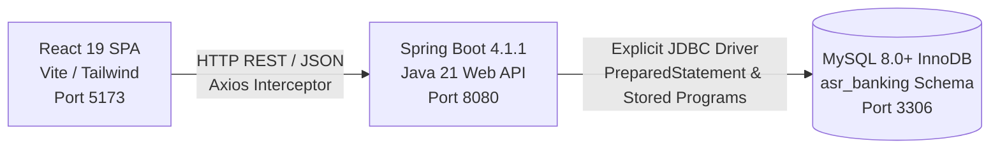
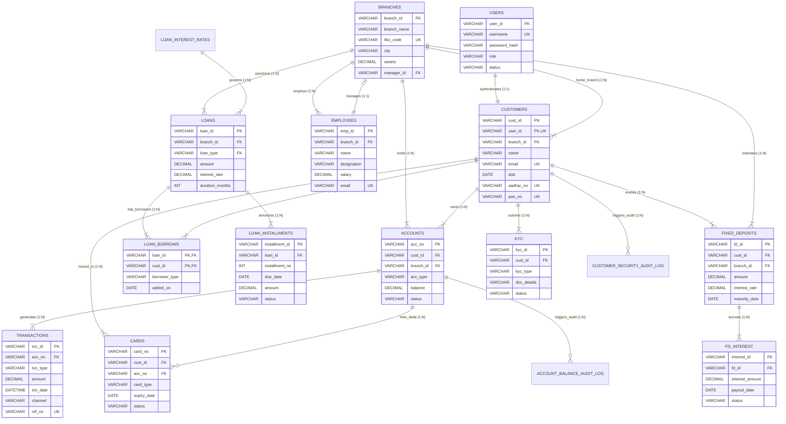
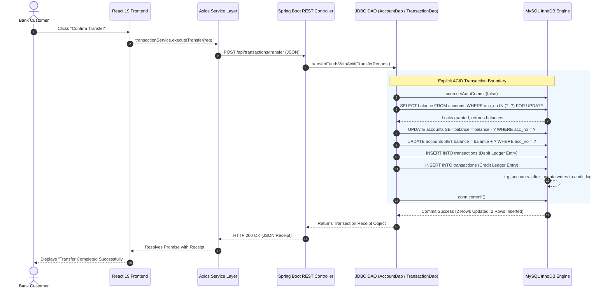
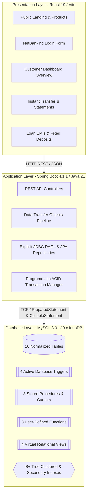

# ASR Bank Simulator — Complete Technical Documentation & System Reference

> **Author / Project Team:** Rutuja, Suraj, Atharva, Shubham  
> **Academic Subject:** Database Management Systems (DBMS) Mini-Project  
> **Course / Degree:** Computer Science & Engineering / Information Technology  
> **Target Platform:** MySQL 8.0+ / 9.x, Spring Boot 4.1.1 (Java 21), React 19 (Vite)  
> **Repository:** `asr-banking-simulator`  
> **Branch:** `dev-rutuja`  
> **Date:** October 2026  

---

## Table of Contents

1. [SECTION 1: Project Overview](#section-1-project-overview)
   - [1.1 Purpose and Academic Goals](#11-purpose-and-academic-goals)
   - [1.2 Real-World Banking Challenges Simulated](#12-real-world-banking-challenges-simulated)
   - [1.3 Core Implemented Capabilities](#13-core-implemented-capabilities)
   - [1.4 System Architecture & Tech Stack Summary](#14-system-architecture--tech-stack-summary)
   - [1.5 Users and Security Roles](#15-users-and-security-roles)
2. [SECTION 2: Complete Project Structure](#section-2-complete-project-structure)
   - [2.1 Repository Directory Tree](#21-repository-directory-tree)
   - [2.2 Detailed File and Component Responsibility Matrix](#22-detailed-file-and-component-responsibility-matrix)
3. [SECTION 3: Frontend Architecture and Implementation](#section-3-frontend-architecture-and-implementation)
   - [3.1 Technology Stack & Dependencies](#31-technology-stack--dependencies)
   - [3.2 Pages & UI Components Inventory](#32-pages--ui-components-inventory)
   - [3.3 Routing Architecture & Protected Route Guards](#33-routing-architecture--protected-route-guards)
   - [3.4 State Management & Data Flow](#34-state-management--data-flow)
   - [3.5 API Service Layer & Axios Client Integration](#35-api-service-layer--axios-client-integration)
4. [SECTION 4: Backend Architecture and Implementation](#section-4-backend-architecture-and-implementation)
   - [4.1 Backend Architecture & Technology Stack](#41-backend-architecture--technology-stack)
   - [4.2 Maven Project Configuration (`pom.xml`)](#42-maven-project-configuration-pomxml)
   - [4.3 REST Controllers & API Catalog](#43-rest-controllers--api-catalog)
   - [4.4 Data Access Strategy: Explicit JDBC DAOs vs. Spring Data JPA Repositories](#44-data-access-strategy-explicit-jdbc-daos-vs-spring-data-jpa-repositories)
   - [4.5 Data Transfer Objects (DTOs) & Data Mapping Pipeline](#45-data-transfer-objects-dtos--data-mapping-pipeline)
5. [SECTION 5: Complete Database Documentation](#section-5-complete-database-documentation)
   - [5.1 Database Overview & Initialization (`Initialize.sql`)](#51-database-overview--initialization-initializesql)
   - [5.2 Complete Database Table Inventory](#52-complete-database-table-inventory)
   - [5.3 Exhaustive Table-by-Table Schema Specification](#53-exhaustive-table-by-table-schema-specification)
   - [5.4 Keys, Constraints & Referential Integrity Semantics](#54-keys-constraints--referential-integrity-semantics)
   - [5.5 Entity Relationships & Formal Cardinality Analysis](#55-entity-relationships--formal-cardinality-analysis)
   - [5.6 Complete Mermaid Entity-Relationship (ER) Diagram](#56-complete-mermaid-entity-relationship-er-diagram)
   - [5.7 Database Normalization Proofs (1NF, 2NF, 3NF & BCNF)](#57-database-normalization-proofs-1nf-2nf-3nf--bcnf)
6. [SECTION 6: Database Features and SQL Operations Implemented](#section-6-database-features-and-sql-operations-implemented)
   - [6.1 Multi-Table Relational JOIN Operations](#61-multi-table-relational-join-operations)
   - [6.2 Aggregations, Grouping & Analytical Reporting](#62-aggregations-grouping--analytical-reporting)
   - [6.3 Correlated Subqueries & Set Operators](#63-correlated-subqueries--set-operators)
   - [6.4 ACID Financial Transactions & Row-Level Locking](#64-acid-financial-transactions--row-level-locking)
   - [6.5 Database Views (Virtual Relations & PII Data Masking)](#65-database-views-virtual-relations--pii-data-masking)
   - [6.6 B+ Tree Secondary Indexes & Covering Index Optimizations](#66-b-tree-secondary-indexes--covering-index-optimizations)
   - [6.7 Stored Procedures & User-Defined Functions (UDFs)](#67-stored-procedures--user-defined-functions-udfs)
   - [6.8 Active Database Triggers & Automated Audit Trails](#68-active-database-triggers--automated-audit-trails)
   - [6.9 Database Cursors & Batch Ledger Processing](#69-database-cursors--batch-ledger-processing)
   - [6.10 Database Security, Roles & SQL Injection Benchmark](#610-database-security-roles--sql-injection-benchmark)
   - [6.11 Performance Tuning, Buffer Pool Metrics & EXPLAIN ANALYZE](#611-performance-tuning-buffer-pool-metrics--explain-analyze)
7. [SECTION 7: End-to-End Communication Flow & Feature Execution Traces](#section-7-end-to-end-communication-flow--feature-execution-traces)
   - [7.1 High-Level Architecture Flowchart](#71-high-level-architecture-flowchart)
   - [7.2 System Communication Boundaries](#72-system-communication-boundaries)
   - [7.3 Request and Response Formats (JSON Payloads)](#73-request-and-response-formats-json-payloads)
   - [7.4 Step-by-Step Feature Traces](#74-step-by-step-feature-traces)
8. [SECTION 8: SQL Query Reference Catalog](#section-8-sql-query-reference-catalog)
   - [8.1 Core Ledger & Account Queries](#81-core-ledger--account-queries)
   - [8.2 Complex Joins, Group By & Subqueries](#82-complex-joins-group-by--subqueries)
   - [8.3 Views, Procedures, Functions, and Cursors](#83-views-procedures-functions-and-cursors)
9. [SECTION 9: Data Integrity, Concurrency & Transaction Management](#section-9-data-integrity-concurrency--transaction-management)
   - [9.1 ACID Invariant Guarantees](#91-acid-invariant-guarantees)
   - [9.2 Deadlock Prevention via Lexicographical Account Locking](#92-deadlock-prevention-via-lexicographical-account-locking)
   - [9.3 Exception Handling & Automatic Rollbacks](#93-exception-handling--automatic-rollbacks)
10. [SECTION 10: Application Configuration & Environment Settings](#section-10-application-configuration--environment-settings)
    - [10.1 Spring Boot DataSource (`application.properties`)](#101-spring-boot-datasource-applicationproperties)
    - [10.2 Frontend Environment (`.env`) & Network Ports](#102-frontend-environment-env--network-ports)
    - [10.3 Cross-Origin Resource Sharing (CORS) Security](#103-cross-origin-resource-sharing-cors-security)
11. [SECTION 11: How to Set Up and Run the Complete System](#section-11-how-to-set-up-and-run-the-complete-system)
    - [11.1 Prerequisites](#111-prerequisites)
    - [11.2 Step-by-Step Initialization & Execution](#112-step-by-step-initialization--execution)
    - [11.3 Troubleshooting Common Errors](#113-troubleshooting-common-errors)
12. [SECTION 12: Testing and Verification Status](#section-12-testing-and-verification-status)
    - [12.1 Automated Test Suites](#121-automated-test-suites)
    - [12.2 Integration Verification & Endpoint Benchmarks](#122-integration-verification--endpoint-benchmarks)
13. [SECTION 13: Core DBMS Concepts Demonstrated](#section-13-core-dbms-concepts-demonstrated)
14. [SECTION 14: Known Limitations and Future Improvements](#section-14-known-limitations-and-future-improvements)
15. [SECTION 15: Master Viva Defense Preparation & Q&A](#section-15-master-viva-defense-preparation--qa)
16. [SECTION 16: Final System Summary & Master Architecture](#section-16-final-system-summary--master-architecture)

---

# SECTION 1: Project Overview

### 1.1 Purpose and Academic Goals
The **ASR Bank Simulator** (*Aapka Secure Rasta Bank*) is a production-grade, three-tier relational banking application engineered specifically to demonstrate core **Database Management System (DBMS)** principles. Rather than building a superficial mockup with client-side state, this project implements a rigorous relational engine where all financial transactions, balance mutations, amortization calculations, interest accruals, audit logs, and security policies are executed and enforced directly inside **MySQL InnoDB** through atomic SQL transactions, stored programs, and check constraints.

### 1.2 Real-World Banking Challenges Simulated
1. **The Double-Debit / Money-Vanishing Problem:** Ensuring that a transfer debits Account A and credits Account B atomically. If power fails or network drops midway, neither account changes (Atomicity).
2. **Negative Balance / Overdraft Violations:** Enforcing strict schema check constraints (`balance >= 0.00`) and trigger-based validation so that no balance can drop below zero under concurrent transfer attempts.
3. **Audit Trail Tampering (SOX / RBI Mandates):** Maintaining immutable append-only audit ledgers (`account_balance_audit_log` and `customer_security_audit_log`) populated implicitly by database triggers, capturing before/after balances, user IDs, and timestamps.
4. **Deadlock in Concurrent Transfers:** Implementing ordered, lexicographical row locking (`SELECT ... FOR UPDATE`) in JDBC to eliminate circular wait deadlocks when two customers transfer funds to each other simultaneously.
5. **PII Exposure & Security:** Securing Personally Identifiable Information (Aadhaar, PAN, passwords) using database views, UDF masking functions, and BCrypt hashing.
6. **SQL Injection Vulnerabilities:** Demonstrating first-hand how legacy unparameterized string concatenation allows attackers to compromise databases (`' OR '1'='1`), and proving mathematically how `java.sql.PreparedStatement` pre-compilation stops SQL injection completely.

### 1.3 Core Implemented Capabilities
- **Customer Authentication:** Role-based access control with password hashing and session tokens.
- **Bank Accounts Management:** Savings and Current accounts with live balance updates, masking controls, and lifecycle status management (Active, Dormant, Frozen, Closed).
- **Multi-Channel Fund Transfers:** Atomic balance transfer across accounts via UPI, IMPS, and NEFT using both explicit JDBC transactions and MySQL Stored Procedures.
- **Transaction History & Ledger Statements:** Paginated, multi-filter ledger inspection (Credit/Debit, Channel, Status) with instant CSV statement generation.
- **Credit Facilities & Loan Amortization:** Loan contracts, M:N joint borrower mapping via junction tables, and installment payment tracking with interest schedules.
- **Fixed Deposits (Term Investments):** Deposit booking, RBI-compliant yield compound calculation, and monthly/annual payout scheduling.
- **Card Lifecycle Management:** Debit and Credit card tracking, instant card freezing/unfreezing, and Green PIN generation.
- **Regulatory KYC Compliance:** Verification documents, UIDAI biometric status, and audit timestamps.
- **Database Engine Benchmarks:** Live REST endpoints exposing buffer pool hit ratios, SQL injection defense benchmarks, trigger audit trails, and `EXPLAIN ANALYZE` execution trees.

### 1.4 System Architecture & Tech Stack Summary
The application follows an enterprise **3-Tier Architecture**:
1. **Presentation Tier (Frontend):** React 19 single-page application built with Vite 8, styled with Tailwind CSS, and using Axios for HTTP REST communication.
2. **Application Tier (Backend):** Java 21 Spring Boot 4.1.1 web service with embedded Apache Tomcat, exposing REST controllers and utilizing raw JDBC (`DataSource`, `Connection`, `PreparedStatement`, `CallableStatement`) alongside Spring Data JPA.
3. **Database Tier (Persistence & Active DB):** MySQL 8.0+ / 9.x relational database running the InnoDB ACID storage engine on port 3306, hosting 16 tables, 4 views, 3 stored procedures, 3 UDFs, 4 triggers, and 3 security roles.



### 1.5 Users and Security Roles
The application defines multiple user classifications:
- **`Customer`:** Retail bank client (e.g., `suraj_w`, `CUST001`) who can query balances, view statements, execute fund transfers, pay EMIs, and book fixed deposits.
- **`bank_teller_role`:** Bank branch staff permitted to execute deposits, withdrawals, and balance queries.
- **`bank_auditor_role`:** Compliance officer with read-only access to transaction ledgers, audit logs, and customer KYC records.
- **`bank_app_service_role`:** Dedicated service account used by Spring Boot to call procedures and execute transactional queries.

---

# SECTION 2: Complete Project Structure

### 2.1 Repository Directory Tree
```
asr-banking-simulator/
├── backend/                                  # Spring Boot 4.1.1 (Java 21) REST Backend
│   ├── pom.xml                              # Maven build & dependency configuration
│   └── src/
│       ├── main/
│       │   ├── java/com/asr/asr_banking_simulator/
│       │   │   ├── AsrBankingSimulatorApplication.java   # Spring Boot Application Entry Point
│       │   │   ├── config/
│       │   │   │   └── CorsConfig.java                   # CORS security headers & origin allowance
│       │   │   ├── controller/                           # 11 REST Controllers
│       │   │   │   ├── AccountController.java
│       │   │   │   ├── AuthController.java
│       │   │   │   ├── BranchController.java
│       │   │   │   ├── CardController.java
│       │   │   │   ├── CustomerController.java
│       │   │   │   ├── FdController.java
│       │   │   │   ├── KycController.java
│       │   │   │   ├── LoanController.java
│       │   │   │   ├── PerformanceController.java
│       │   │   │   ├── SecurityController.java
│       │   │   │   └── TransactionController.java
│       │   │   ├── dao/                                  # Explicit JDBC Data Access Objects
│       │   │   │   ├── AccountDao.java                   # 1,100+ lines of explicit SQL & JDBC
│       │   │   │   └── TransactionDao.java               # ACID transfer & CallableStatement calls
│       │   │   ├── dto/                                  # 18 Data Transfer Objects
│       │   │   │   ├── AccountBalanceAuditDto.java
│       │   │   │   ├── AccountTypeSummaryDto.java
│       │   │   │   ├── BatchInterestResultDto.java
│       │   │   │   ├── BranchLiquidityDto.java
│       │   │   │   ├── BufferPoolMetricsDto.java
│       │   │   │   ├── CustomerAccountBranchDto.java
│       │   │   │   ├── CustomerPortfolioSummaryDto.java
│       │   │   │   ├── CustomerSecurityAuditDto.java
│       │   │   │   ├── CustomerTierDto.java
│       │   │   │   ├── FdMaturityQuoteDto.java
│       │   │   │   ├── LoginRequest.java
│       │   │   │   ├── LoginResponse.java
│       │   │   │   ├── ProcedureTransferResultDto.java
│       │   │   │   ├── QueryExplainPlanDto.java
│       │   │   │   ├── RolePrivilegeDto.java
│       │   │   │   ├── SqlInjectionDemoDto.java
│       │   │   │   ├── StatusUpdateRequest.java
│       │   │   │   └── TransferRequest.java
│       │   │   ├── model/                                # 15 JPA Entity Models
│       │   │   │   ├── Account.java
│       │   │   │   ├── Branch.java
│       │   │   │   ├── Card.java
│       │   │   │   ├── Customer.java
│       │   │   │   ├── Employee.java
│       │   │   │   ├── FdInterest.java
│       │   │   │   ├── FixedDeposit.java
│       │   │   │   ├── Kyc.java
│       │   │   │   ├── Loan.java
│       │   │   │   ├── LoanBorrower.java
│       │   │   │   ├── LoanBorrowerId.java
│       │   │   │   ├── LoanInstallment.java
│       │   │   │   ├── LoanInterestRate.java
│       │   │   │   ├── Transaction.java
│       │   │   │   └── User.java
│       │   │   └── repository/                           # 14 Spring Data JPA Repositories
│       │   │       ├── AccountRepository.java
│       │   │       ├── BranchRepository.java
│       │   │       ├── CardRepository.java
│       │   │       ├── CustomerRepository.java
│       │   │       ├── EmployeeRepository.java
│       │   │       ├── FdInterestRepository.java
│       │   │       ├── FixedDepositRepository.java
│       │   │       ├── KycRepository.java
│       │   │       ├── LoanBorrowerRepository.java
│       │   │       ├── LoanInstallmentRepository.java
│       │   │       ├── LoanInterestRateRepository.java
│       │   │       ├── LoanRepository.java
│       │   │       ├── TransactionRepository.java
│       │   │       └── UserRepository.java
│       │   └── resources/
│       │       └── application.properties                # Database connection, port & JPA configuration
│       └── test/
│           └── java/com/asr/asr_banking_simulator/
│               └── AsrBankingSimulatorApplicationTests.java # Context loading test
├── database/                                 # Database DDL & SQL Learning Curriculum
│   ├── Initialize.sql                        # Master DDL (14 tables, constraints, initial seed data)
│   └── learning/                             # 14 DBMS Educational Scripts (Stages 1-14)
│       ├── 01_basic_sql.sql
│       ├── 02_crud_operations.sql
│       ├── 03_joins_and_relationships.sql
│       ├── 04_aggregations_and_groupby.sql
│       ├── 05_subqueries_and_set_operations.sql
│       ├── 06_transactions_and_acid.sql
│       ├── 07_normalization_and_integrity_proofs.sql
│       ├── 08_database_views.sql
│       ├── 09_indexes_and_query_optimization.sql
│       ├── 10_stored_procedures_and_functions.sql
│       ├── 11_database_triggers.sql
│       ├── 12_database_cursors.sql
│       ├── 13_database_security_and_roles.sql
│       └── 14_performance_tuning_and_profiling.sql
├── frontend/                                 # React 19 + Vite 8 SPA Client
│   ├── index.html                           # Single page entry HTML
│   ├── package.json                         # Frontend dependencies & Vite scripts
│   ├── tailwind.config.js                   # Tailwind CSS styling configuration
│   ├── vite.config.js                       # Vite build runner
│   ├── .env                                 # Environment variables (VITE_API_BASE_URL, VITE_USE_MOCK)
│   └── src/
│       ├── App.jsx                          # Root React component with AuthProvider
│       ├── main.jsx                         # ReactDOM mount point
│       ├── index.css                        # Global Tailwind styles & font imports
│       ├── context/
│       │   └── AuthContext.jsx              # Authentication context & session persistence
│       ├── data/
│       │   └── mockData.js                  # Fallback mock dataset mirroring 14 SQL tables
│       ├── layouts/
│       │   ├── DashboardLayout.jsx          # Protected layout shell (Sidebar + Topbar + Content)
│       │   └── PublicLayout.jsx             # Public layout shell (Navbar + Content + Footer)
│       ├── pages/
│       │   ├── auth/
│       │   │   └── LoginPage.jsx            # NetBanking login & credential recovery
│       │   ├── dashboard/                   # Customer NetBanking Portal
│       │   │   ├── AccountsPage.jsx         # Linked accounts, balances, instant transfer
│       │   │   ├── CardsPage.jsx            # Debit/Credit card freeze & PIN setup
│       │   │   ├── DashboardHome.jsx        # Dashboard overview alias
│       │   │   ├── FDPage.jsx               # Fixed deposit booking & yield calculator
│       │   │   ├── LoansPage.jsx            # Loans list, amortized EMIs & repayment
│       │   │   ├── OverviewPage.jsx         # Consolidated dashboard overview & quick actions
│       │   │   ├── ProfilePage.jsx          # Customer profile & PMLA KYC verification
│       │   │   └── TransactionsPage.jsx     # Transaction statement, filters & CSV export
│       │   └── public/                      # Public Website Pages
│       │       ├── AboutPage.jsx            # Mission, architecture & team details
│       │       ├── ContactPage.jsx          # Branches list & inquiry form
│       │       ├── HomePage.jsx             # Landing page with trust stats & product highlights
│       │       └── ProductsPage.jsx         # Retail banking products catalog
│       ├── routes/
│       │   ├── AppRoutes.jsx                # React Router DOM 7 routing configuration
│       │   └── ProtectedRoute.jsx           # Route guard redirecting unauthenticated users
│       ├── services/                        # Axios API Client & Endpoint Wrappers
│       │   ├── accountService.js
│       │   ├── api.js                       # Central Axios instance with base URL & interceptors
│       │   ├── authService.js
│       │   ├── cardService.js
│       │   ├── customerService.js
│       │   ├── fdInterestService.js
│       │   ├── fdService.js
│       │   ├── index.js
│       │   ├── kycService.js
│       │   ├── loanInstallmentService.js
│       │   ├── loanService.js
│       │   └── transactionService.js
│       └── utils/
│           ├── formatters.js                # Currency (INR), date & percentage formatters
│           └── maskers.js                   # Account number, Aadhaar & card masking
└── docs/                                    # Stage documentation & architectural logs
```

### 2.2 Detailed File and Component Responsibility Matrix

| Path | Primary Responsibility | Consumed By | Key Technical Details |
|---|---|---|---|
| `database/Initialize.sql` | Authoritative MySQL DDL schema and initial seed data | MySQL Engine | 14 tables, constraints, foreign keys, UTF-8 collation |
| `database/learning/10_*.sql` | Stored Procedures (`sp_execute_interbank_transfer`) & UDFs | MySQL / Backend | Procedural PL/SQL, `CallableStatement`, exception handling |
| `database/learning/11_*.sql` | Database Triggers & Audit Log DDL | MySQL Engine | `BEFORE`/`AFTER` triggers, `SIGNAL SQLSTATE`, audit tables |
| `database/learning/12_*.sql` | Database Cursor for batch monthly interest | MySQL Engine | `DECLARE CURSOR`, `FETCH`, `NOT FOUND` handler |
| `backend/.../AccountDao.java` | Explicit JDBC operations for accounts, joins, aggregations, profiling | `AccountController`, `CustomerController` | `DataSource`, `PreparedStatement`, `ResultSet`, resource management |
| `backend/.../TransactionDao.java` | ACID fund transfers and stored procedure execution | `TransactionController` | `setAutoCommit(false)`, `commit()`, `rollback()`, row-level locking |
| `backend/.../AccountController.java` | REST API for account balances, summaries, audit trail, batch cursor | Frontend `accountService.js` | `@RestController`, `@RequestMapping("/api/accounts")` |
| `backend/.../TransactionController.java` | REST API for ledger queries and transfer execution | Frontend `transactionService.js` | `@PostMapping("/transfer")`, `@PostMapping("/procedure-transfer")` |
| `backend/.../SecurityController.java` | SQL Injection demonstration & role catalog API | Security Benchmarking | Exposes vulnerable vs prepared statement benchmarks |
| `backend/.../PerformanceController.java` | Buffer pool metrics & `EXPLAIN ANALYZE` profiling | Performance Dashboard | Direct SQL queries against `information_schema` |
| `frontend/src/services/api.js` | Central Axios HTTP client with interceptors | All frontend services | Targets `http://localhost:8080`, handles 401 redirects |
| `frontend/src/pages/dashboard/AccountsPage.jsx` | User interface for account cards & fund transfer | React Router (`/dashboard/accounts`) | Renders `AccountCard`, initiates transfers, updates balance |
| `frontend/src/pages/dashboard/TransactionsPage.jsx` | Ledger search, multi-criteria filtering & CSV export | React Router (`/dashboard/transactions`) | Client-side CSV generator, filter controls, modal receipt |
| `frontend/src/pages/dashboard/LoansPage.jsx` | Loan account cards, EMI schedule & repayment modal | React Router (`/dashboard/loans`) | Renders `LoanCard`, invokes `loanInstallmentService` |
| `frontend/src/pages/dashboard/FDPage.jsx` | Fixed deposit contracts, yield calculation & booking | React Router (`/dashboard/fd`) | Compound interest calculation, `fdService` |

---

# SECTION 3: Frontend Architecture and Implementation

### 3.1 Technology Stack & Dependencies
The frontend is built using **React 19.2.8** initialized with **Vite 8.3.0**. 
- **React (`react`, `react-dom` v19.2.8):** Modern declarative UI utilizing functional components and React Hooks (`useState`, `useEffect`, `useMemo`, `useCallback`, `useContext`).
- **React Router DOM (`react-router-dom` v7.18.4):** Handles client-side navigation, nested layout routing, and declarative route guards.
- **Axios (`axios` v1.20.0):** Promise-based HTTP client for executing asynchronous calls against Spring Boot REST controllers.
- **Lucide React (`lucide-react` v1.49.0):** Consistent SVG iconography used across the design system.
- **Tailwind CSS (`tailwindcss` v3.4.19):** Utility-first styling with custom colors (`#003366` institutional navy, `#002244` dark navy, slate neutrals, emerald success accents).

### 3.2 Pages & UI Components Inventory

#### Public Pages
1. **`HomePage.jsx` (`/`):** Hero section with branding (*ASR Bank — Aapka Secure Rasta*), quick product feature cards, live institutional stats banner (`TrustStats.jsx`), and NetBanking CTA.
2. **`ProductsPage.jsx` (`/products`):** Interactive retail banking catalog covering Savings Accounts, Current Accounts, Personal Loans, Fixed Deposits, and Debit/Credit Cards.
3. **`AboutPage.jsx` (`/about`):** Explains institutional mission, team engineering contributions, 3-tier architecture, and enterprise ACID guarantees.
4. **`ContactPage.jsx` (`/contact`):** Branch directory with branch addresses, IFSC codes, phone numbers, and inquiry submission.

#### Authentication Pages
1. **`LoginPage.jsx` (`/login`):** Customer login form requiring username and password, with 256-bit SSL badges, password show/hide toggle, error handling, credential assistance modal (`suraj_w` / `demo123`), and registration guidance.

#### Customer NetBanking Dashboard Pages (Protected)
1. **`OverviewPage.jsx` (`/dashboard`):** Consolidated customer overview displaying total liquid balance across accounts, active loan counts, total fixed deposits, quick banking action ribbon, recent ledger activity, and linked account cards.
2. **`AccountsPage.jsx` (`/dashboard/accounts`):** Detailed view of all customer accounts (Savings, Current), balance masking/unmasking toggle, account opening dates, branch IFSC details, and an **Instant Fund Transfer** modal supporting UPI, NEFT, and IMPS.
3. **`TransactionsPage.jsx` (`/dashboard/transactions`):** Full ledger statement table with pagination, multi-criteria filtering (search query, transaction type, channel, status, account), transaction receipt modal, and **real-time CSV Statement Export**.
4. **`LoansPage.jsx` (`/dashboard/loans`):** Credit facilities inspection displaying sanctioned amounts, interest rates, tenure, amortization progress, expandable installment tables, and an **EMI Repayment** modal.
5. **`FDPage.jsx` (`/dashboard/fd`):** Fixed deposit term contracts, accrued interest tracking, expandable interest schedule table, **Yield Calculator**, and **Book New FD** modal.
6. **`CardsPage.jsx` (`/dashboard/cards`):** Debit and Credit cards display with visual chip layout, instant lock/unlock toggle, domestic/international limits, and **Instant Green PIN Generation**.
7. **`ProfilePage.jsx` (`/dashboard/profile`):** Master demographic details, verified mobile/email channels, masked Aadhaar display, and Prevention of Money Laundering Act (PMLA) regulatory KYC verification logs.

### 3.3 Routing Architecture & Protected Route Guards
Routing is declared centrally in `src/routes/AppRoutes.jsx`:

| Path | Layout | Protected? | Component | Purpose |
|---|---|---|---|---|
| `/` | `PublicLayout` | No | `HomePage` | Public portal landing page |
| `/about` | `PublicLayout` | No | `AboutPage` | Institutional & technical overview |
| `/products` | `PublicLayout` | No | `ProductsPage` | Banking product showcase |
| `/contact` | `PublicLayout` | No | `ContactPage` | Branches & branch locator |
| `/login` | None (standalone) | No | `LoginPage` | NetBanking login & authentication |
| `/dashboard` | `DashboardLayout` | **Yes** | `OverviewPage` | Consolidated financial dashboard |
| `/dashboard/accounts` | `DashboardLayout` | **Yes** | `AccountsPage` | Bank accounts & fund transfer |
| `/dashboard/transactions` | `DashboardLayout` | **Yes** | `TransactionsPage` | Financial ledger & statement export |
| `/dashboard/loans` | `DashboardLayout` | **Yes** | `LoansPage` | Loans & EMI repayments |
| `/dashboard/fd` | `DashboardLayout` | **Yes** | `FDPage` | Fixed deposits & interest yield |
| `/dashboard/cards` | `DashboardLayout` | **Yes** | `CardsPage` | Card management & PIN setup |
| `/dashboard/profile` | `DashboardLayout` | **Yes** | `ProfilePage` | Customer demographics & KYC records |
| `*` | None | No | Redirect to `/` | Fallback route handler |

**The `ProtectedRoute` Guard (`src/routes/ProtectedRoute.jsx`):**
```jsx
const ProtectedRoute = ({ children }) => {
  const { isAuthenticated, loading } = useAuth();
  if (loading) return <LoadingState message="Verifying session..." fullPage />;
  if (!isAuthenticated) return <Navigate to="/login" replace />;
  return children;
};
```
If `localStorage` does not contain a verified `asr_bank_session`, unauthenticated users are immediately redirected to `/login`.

### 3.4 State Management & Data Flow
1. **Global Auth State (`AuthContext.jsx`):** Stores `user` object, `customer` profile, `token`, and `isAuthenticated` flag. Session state is serialized to `localStorage` under `asr_bank_session` to persist across page refreshes.
2. **Page-Level Reactive State:** Each dashboard page manages its own component lifecycle:
   - Sets `loading = true`.
   - Fires `useEffect` on mount to invoke the corresponding service method.
   - Updates local state with returned JSON data.
   - Sets `loading = false` and renders clean cards or tables.
3. **Optimistic & Immediate UI Mutation:** When an action occurs (e.g. executing a fund transfer, freezing a card, or paying an EMI), the component issues the backend API call, updates local state upon success, and re-fetches updated account balances to ensure visual consistency.

### 3.5 API Service Layer & Axios Client Integration
The central Axios configuration resides in `src/services/api.js`:
- **Base URL:** `http://localhost:8080` (configured via `import.meta.env.VITE_API_BASE_URL`).
- **Timeout:** 10,000 milliseconds (10s).
- **Request Interceptor:** Automatically injects `Authorization: Bearer <token>` into outgoing request headers if a session exists.
- **Response Interceptor:** Automatically catches HTTP 401 Unauthorized errors, clears the invalid session, and redirects to `/login`.
- **`VITE_USE_MOCK` Switch:** Every service module inspects `const USE_MOCK = import.meta.env.VITE_USE_MOCK !== "false"`. When `VITE_USE_MOCK=false` (as set in `.env`), all calls route directly over the network to the Spring Boot REST backend.

---

# SECTION 4: Backend Architecture and Implementation

### 4.1 Backend Architecture & Technology Stack
The backend is a lightweight, high-performance Spring Boot service structured around explicit database communication:
- **Language / Runtime:** Java 21 (OpenJDK).
- **Framework:** Spring Boot 4.1.1 (`spring-boot-starter-webmvc`, `spring-boot-starter-data-jpa`).
- **Build System:** Apache Maven 3.9+.
- **Database Driver:** `com.mysql:mysql-connector-j` (MySQL Connector/J 9.x).
- **Persistence Paradigms:**
  - **Explicit JDBC (`AccountDao`, `TransactionDao`):** Direct SQL query execution, transaction boundary management, stored procedures, cursor execution, and security benchmarking.
  - **Spring Data JPA Repositories:** Standard CRUD operations on basic entity lookups.

### 4.2 Maven Project Configuration (`pom.xml`)
Key dependencies defined in `backend/pom.xml`:
```xml
<parent>
    <groupId>org.springframework.boot</groupId>
    <artifactId>spring-boot-starter-parent</artifactId>
    <version>4.1.1</version>
</parent>
<properties>
    <java.version>21</java.version>
</properties>
<dependencies>
    <!-- Web MVC for REST Controllers -->
    <dependency>
        <groupId>org.springframework.boot</groupId>
        <artifactId>spring-boot-starter-webmvc</artifactId>
    </dependency>
    <!-- Spring Data JPA & HikariCP Connection Pooling -->
    <dependency>
        <groupId>org.springframework.boot</groupId>
        <artifactId>spring-boot-starter-data-jpa</artifactId>
    </dependency>
    <!-- Official MySQL 8/9 JDBC Connector -->
    <dependency>
        <groupId>com.mysql</groupId>
        <artifactId>mysql-connector-j</artifactId>
        <scope>runtime</scope>
    </dependency>
    <!-- Testing Frameworks -->
    <dependency>
        <groupId>org.springframework.boot</groupId>
        <artifactId>spring-boot-starter-webmvc-test</artifactId>
        <scope>test</scope>
    </dependency>
</dependencies>
```

### 4.3 REST Controllers & API Catalog
The backend provides 11 REST controllers exposing 37 distinct endpoints:

| HTTP Method | Endpoint Path | Controller | Purpose | Request Body / Params | Response Type | Data Access Layer |
|---|---|---|---|---|---|---|
| `POST` | `/api/auth/login` | `AuthController` | Authenticate customer credentials | `LoginRequest` (username, password) | `LoginResponse` | JPA `UserRepository` + `CustomerRepository` |
| `POST` | `/api/auth/logout` | `AuthController` | Terminate session | None | Map (status: logged_out) | In-Memory |
| `GET` | `/api/accounts` | `AccountController` | Retrieve all accounts | None | `List<Account>` | JDBC `AccountDao.findAllAccounts()` |
| `GET` | `/api/accounts/customer/{custId}` | `AccountController` | Get accounts by Customer ID | Path: `custId` | `List<Account>` | JDBC `AccountDao.findAccountsByCustomerId()` |
| `GET` | `/api/accounts/customer/{custId}/details` | `AccountController` | 3-Table JOIN (Account + Branch + Customer) | Path: `custId` | `List<CustomerAccountBranchDto>` | JDBC `AccountDao.findCustomerAccountsWithBranch()` |
| `GET` | `/api/accounts/summary/by-type` | `AccountController` | GROUP BY summary by account type | None | `List<AccountTypeSummaryDto>` | JDBC `AccountDao.getAccountTypeSummary()` |
| `GET` | `/api/accounts/customer/{custId}/summary` | `AccountController` | Customer portfolio aggregate metrics | Path: `custId` | `CustomerPortfolioSummaryDto` | JDBC `AccountDao.getCustomerPortfolioSummary()` |
| `GET` | `/api/accounts/high-value` | `AccountController` | Subquery: accounts above bank-wide average | None | `List<Account>` | JDBC `AccountDao.findHighValueAccountsAboveAverage()` |
| `GET` | `/api/accounts/deposit-only-customers` | `AccountController` | Correlated `NOT EXISTS` subquery | None | `List<Customer>` | JDBC `AccountDao.findDepositOnlyCustomers()` |
| `GET` | `/api/accounts/views/branch-liquidity` | `AccountController` | Query `view_branch_liquidity_summary` | None | `List<BranchLiquidityDto>` | JDBC `AccountDao.findBranchLiquidityFromView()` |
| `GET` | `/api/accounts/{accNo}` | `AccountController` | Find account by account number | Path: `accNo` | `Account` | JDBC `AccountDao.findAccountByNumber()` |
| `POST` | `/api/accounts` | `AccountController` | Insert new bank account | `Account` entity | `Account` | JDBC `AccountDao.insertAccount()` |
| `PATCH` | `/api/accounts/{accNo}/status` | `AccountController` | Update account status | Path: `accNo`, `StatusUpdateRequest` | `Account` | JDBC `AccountDao.updateAccountStatus()` |
| `DELETE` | `/api/accounts/{accNo}` | `AccountController` | Hard delete account | Path: `accNo` | Status 204 / 400 | JDBC `AccountDao.deleteAccount()` |
| `POST` | `/api/accounts/{accNo}/close` | `AccountController` | Soft-close account | Path: `accNo` | `Account` | JDBC `AccountDao.closeAccount()` |
| `GET` | `/api/accounts/functions/fd-maturity-quote` | `AccountController` | Execute UDF `fn_calculate_fd_maturity` | Params: `principal`, `rate`, `months` | `FdMaturityQuoteDto` | JDBC `AccountDao.calculateFdMaturity()` |
| `GET` | `/api/accounts/functions/customer-tier/{custId}` | `AccountController` | Execute UDF `fn_customer_tier` & `fn_mask_account_number` | Path: `custId` | `CustomerTierDto` | JDBC `AccountDao.getCustomerTierAndMaskedAccount()` |
| `GET` | `/api/accounts/{accNo}/audit-trail` | `AccountController` | Query `account_balance_audit_log` | Path: `accNo` | `List<AccountBalanceAuditDto>` | JDBC `AccountDao.findBalanceAuditTrail()` |
| `POST` | `/api/accounts/batch/monthly-interest` | `AccountController` | Execute Cursor Batch Interest Procedure | Query param: `annualRate` | `BatchInterestResultDto` | JDBC `AccountDao.runMonthlyInterestBatch()` |
| `GET` | `/api/transactions` | `TransactionController` | Get all transactions (limit 100) | None | `List<Transaction>` | JPA `TransactionRepository.findAll()` |
| `GET` | `/api/transactions/account/{accNo}` | `TransactionController` | Get transactions for specific account | Path: `accNo` | `List<Transaction>` | JDBC `TransactionDao.findTransactionsByAccount()` |
| `GET` | `/api/transactions/account/{accNo}/statement` | `TransactionController` | Date-filtered account statement | Params: `startDate`, `endDate` | `List<Transaction>` | JDBC `TransactionDao.findStatementByDateRange()` |
| `GET` | `/api/transactions/{txnId}` | `TransactionController` | Find transaction by Txn ID | Path: `txnId` | `Transaction` | JPA `TransactionRepository.findById()` |
| `POST` | `/api/transactions` | `TransactionController` | Create single ledger transaction | `Transaction` entity | `Transaction` | JPA `TransactionRepository.save()` |
| `POST` | `/api/transactions/transfer` | `TransactionController` | **ACID Multi-Table Fund Transfer** | `TransferRequest` (from, to, amount, channel) | `Transaction` receipt | JDBC `TransactionDao.transferFundsWithAcid()` |
| `POST` | `/api/transactions/procedure-transfer` | `TransactionController` | **Stored Procedure Transfer** | `TransferRequest` | `ProcedureTransferResultDto` | JDBC `TransactionDao.executeTransferViaStoredProcedure()` |
| `GET` | `/api/customers` | `CustomerController` | List all bank customers | None | `List<Customer>` | JPA `CustomerRepository.findAll()` |
| `GET` | `/api/customers/{custId}` | `CustomerController` | Get customer by ID | Path: `custId` | `Customer` | JPA `CustomerRepository.findById()` |
| `GET` | `/api/customers/{custId}/kyc` | `CustomerController` | Get customer KYC documents | Path: `custId` | `List<Kyc>` | JPA `KycRepository.findByCustId()` |
| `PUT` | `/api/customers/{custId}` | `CustomerController` | Update customer phone/email/address | Path: `custId`, `Customer` body | `Customer` | JPA `CustomerRepository.save()` |
| `GET` | `/api/customers/{custId}/security-audit` | `CustomerController` | Query `customer_security_audit_log` | Path: `custId` | `List<CustomerSecurityAuditDto>` | JDBC `AccountDao.findCustomerSecurityAudit()` |
| `GET` | `/api/cards` | `CardController` | Get all cards | None | `List<Card>` | JPA `CardRepository.findAll()` |
| `GET` | `/api/cards/customer/{custId}` | `CardController` | Get cards by customer ID | Path: `custId` | `List<Card>` | JPA `CardRepository.findByCustId()` |
| `PATCH` | `/api/cards/{cardNo}/status` | `CardController` | Update card status (Active/Blocked) | Path: `cardNo`, `StatusUpdateRequest` | `Card` | JPA `CardRepository.save()` |
| `GET` | `/api/loans` | `LoanController` | Get all loans | None | `List<Loan>` | JPA `LoanRepository.findAll()` |
| `GET` | `/api/loans/customer/{custId}` | `LoanController` | Get loans by customer ID via junction | Path: `custId` | `List<Loan>` | JPA `LoanRepository.findLoansByCustomerId()` |
| `GET` | `/api/loans/{loanId}/installments` | `LoanController` | Get EMI installment schedule | Path: `loanId` | `List<LoanInstallment>` | JPA `LoanInstallmentRepository.findByLoanId()` |
| `POST` | `/api/loans/{loanId}/installments/{instId}/pay` | `LoanController` | Pay loan installment | Path: `loanId`, `instId` | `LoanInstallment` | JPA `LoanInstallmentRepository.save()` |
| `GET` | `/api/fds` | `FdController` | List all fixed deposits | None | `List<FixedDeposit>` | JPA `FixedDepositRepository.findAll()` |
| `GET` | `/api/fds/customer/{custId}` | `FdController` | Get fixed deposits for customer | Path: `custId` | `List<FixedDeposit>` | JPA `FixedDepositRepository.findByCustId()` |
| `POST` | `/api/fds` | `FdController` | Open new fixed deposit | `FixedDeposit` body | `FixedDeposit` | JPA `FixedDepositRepository.save()` |
| `GET` | `/api/branches` | `BranchController` | Get all physical branches | None | `List<Branch>` | JPA `BranchRepository.findAll()` |
| `GET` | `/api/security/sql-injection-benchmark` | `SecurityController` | Compare Vulnerable vs Prepared Stmt | Param: `payload` | `SqlInjectionDemoDto` | JDBC `AccountDao.simulateSqlInjectionVulnerability()` |
| `GET` | `/api/security/roles-catalog` | `SecurityController` | Inspect active MySQL security roles | None | `List<RolePrivilegeDto>` | JDBC `AccountDao.findActiveRolePrivileges()` |
| `GET` | `/api/performance/buffer-pool-metrics` | `PerformanceController` | Query InnoDB buffer pool hit ratio | None | `BufferPoolMetricsDto` | JDBC `AccountDao.getBufferPoolMetrics()` |
| `GET` | `/api/performance/explain-analyze` | `PerformanceController` | Profiling execution tree | Param: `accNo` | `QueryExplainPlanDto` | JDBC `AccountDao.explainTransactionStatementQuery()` |

### 4.4 Data Access Strategy: Explicit JDBC DAOs vs. Spring Data JPA Repositories
In this architecture, responsibilities are deliberately divided:
1. **Explicit JDBC DAOs (`AccountDao`, `TransactionDao`):**
   - **Why JDBC?** Educational rigor and transaction control. To understand DBMS concepts, students must write raw SQL, execute prepared statements, bind indexed parameters, process `ResultSet` cursors, and invoke stored procedures via `CallableStatement`.
   - **Transaction Management:** Handled directly via `java.sql.Connection` methods: `conn.setAutoCommit(false)`, `conn.commit()`, and `conn.rollback()`.
   - **Resource Management:** Every method strictly implements Java 7 `try-with-resources` ensuring `Connection`, `PreparedStatement`, and `ResultSet` are closed immediately after execution, preventing HikariCP pool exhaustion.
2. **Spring Data JPA Repositories (`AccountRepository`, etc.):**
   - Used for straightforward lookup operations where hand-writing repetitive boilerplate would obscure the primary DBMS learning focus.

### 4.5 Data Transfer Objects (DTOs) & Data Mapping Pipeline
When complex SQL queries execute multi-table JOINs or aggregate functions, the resulting columns do not map 1-to-1 with individual entity tables. DTOs bridge this gap:
```
MySQL ResultSet Row 
   ↓ (Manual JDBC mapping in DAO: rs.getString(), rs.getBigDecimal())
Java DTO Instance (e.g., CustomerAccountBranchDto)
   ↓ (Spring Web / Jackson JSON Serializer)
HTTP Response Body: application/json
   ↓ (Axios HTTP Client)
React Component State (props / useState)
```

---

# SECTION 5: Complete Database Documentation

### 5.1 Database Overview & Initialization (`Initialize.sql`)
- **RDBMS Engine:** MySQL 8.0+ / 9.x (InnoDB Storage Engine).
- **Database Name:** `asr_banking`.
- **Character Set & Collation:** `utf8mb4` with `utf8mb4_unicode_ci` (full multilingual support).
- **Initialization Script:** `database/Initialize.sql` contains the complete schema, drops existing tables in reverse dependency order, creates tables with primary/foreign/check constraints, resolves circular dependencies via `ALTER TABLE`, and populates realistic seed data.

### 5.2 Complete Database Table Inventory

| # | Table Name | Purpose | Primary Key | Foreign Keys | Related Entities |
|---|---|---|---|---|---|
| 1 | `users` | NetBanking login identities & role authorization | `user_id` | None | `customers` |
| 2 | `branches` | Physical branch network & total asset reserves | `branch_id` | `manager_id` -> `employees(emp_id)` | `employees`, `customers`, `accounts`, `loans`, `fixed_deposits` |
| 3 | `employees` | Staff personnel, designations, salaries & branch linkage | `emp_id` | `branch_id` -> `branches(branch_id)` | `branches` |
| 4 | `customers` | Master demographic, contact & citizen identity records | `cust_id` | `user_id` -> `users(user_id)`, `branch_id` -> `branches(branch_id)` | `users`, `branches`, `accounts`, `loan_borrows`, `fixed_deposits`, `cards`, `kyc` |
| 5 | `accounts` | Liquid deposit contracts (Savings, Current, Salary) | `acc_no` | `cust_id` -> `customers(cust_id)`, `branch_id` -> `branches(branch_id)` | `customers`, `branches`, `transactions`, `cards` |
| 6 | `transactions` | Immutable financial ledger auditing debits & credits | `txn_id` | `acc_no` -> `accounts(acc_no)` | `accounts` |
| 7 | `loan_interest_rates` | Benchmark interest rate and tenure catalog | `loan_type` | None | `loans` |
| 8 | `loans` | Approved retail credit facilities & sanction terms | `loan_id` | `branch_id` -> `branches(branch_id)`, `loan_type` -> `loan_interest_rates(loan_type)` | `branches`, `loan_interest_rates`, `loan_borrows`, `loan_installments` |
| 9 | `loan_borrows` | **Junction Table:** Resolves M:N joint borrower relationship | Composite (`loan_id`, `cust_id`) | `loan_id` -> `loans(loan_id)`, `cust_id` -> `customers(cust_id)` | `loans`, `customers` |
| 10 | `loan_installments` | Amortization schedule & EMI repayment records | `installment_id` | `loan_id` -> `loans(loan_id)` | `loans` |
| 11 | `fixed_deposits` | Term deposit contracts with compounding returns | `fd_id` | `cust_id` -> `customers(cust_id)`, `branch_id` -> `branches(branch_id)` | `customers`, `branches`, `fd_interest` |
| 12 | `fd_interest` | Yield calculation & periodic interest payout ledger | `interest_id` | `fd_id` -> `fixed_deposits(fd_id)` | `fixed_deposits` |
| 13 | `cards` | Debit and Credit cards linked to customer & accounts | `card_no` | `cust_id` -> `customers(cust_id)`, `acc_no` -> `accounts(acc_no)` | `customers`, `accounts` |
| 14 | `kyc` | Regulatory verification documents & compliance logs | `kyc_id` | `cust_id` -> `customers(cust_id)` | `customers` |
| 15 | `account_balance_audit_log` | **Audit Table:** Trigger-logged balance & status history | `audit_id` (Auto-Inc) | None (Denormalized audit record) | `accounts` |
| 16 | `customer_security_audit_log` | **Audit Table:** Trigger-logged PII modification audit trail | `log_id` (Auto-Inc) | None (Denormalized audit record) | `customers` |

---

### 5.3 Exhaustive Table-by-Table Schema Specification

#### 1. `users`
**Purpose:** Manages authentication credentials, user status, and application authorization roles.
```sql
CREATE TABLE users (
    user_id VARCHAR(20) NOT NULL,
    username VARCHAR(50) NOT NULL,
    password_hash VARCHAR(255) NOT NULL,
    role VARCHAR(20) NOT NULL DEFAULT 'Customer',
    contact_no VARCHAR(20) NOT NULL,
    status VARCHAR(20) NOT NULL DEFAULT 'Active',
    created_at TIMESTAMP NOT NULL DEFAULT CURRENT_TIMESTAMP,
    CONSTRAINT pk_users PRIMARY KEY (user_id),
    CONSTRAINT uq_users_username UNIQUE (username),
    CONSTRAINT chk_users_role CHECK (role IN ('Customer', 'Employee', 'Manager', 'Admin')),
    CONSTRAINT chk_users_status CHECK (status IN ('Active', 'Suspended', 'Deactivated'))
) ENGINE=InnoDB;
```
- **Primary Key:** `user_id` (Natural key, alphanumeric, e.g. `USR001`).
- **Unique Constraint:** `uq_users_username` prevents duplicate login IDs.
- **Check Constraints:** `role` restricted to Customer/Employee/Manager/Admin; `status` restricted to Active/Suspended/Deactivated.

#### 2. `branches`
**Purpose:** Physical branch locations, reserve assets, and branch manager hierarchy.
```sql
CREATE TABLE branches (
    branch_id VARCHAR(20) NOT NULL,
    branch_name VARCHAR(100) NOT NULL,
    ifsc_code VARCHAR(15) NOT NULL,
    city VARCHAR(50) NOT NULL,
    address VARCHAR(255) NOT NULL,
    assets DECIMAL(18, 2) NOT NULL DEFAULT 50000000.00,
    manager_id VARCHAR(20) NULL,
    created_at TIMESTAMP NOT NULL DEFAULT CURRENT_TIMESTAMP,
    CONSTRAINT pk_branches PRIMARY KEY (branch_id),
    CONSTRAINT uq_branches_ifsc UNIQUE (ifsc_code),
    CONSTRAINT chk_branches_assets CHECK (assets >= 0.00)
) ENGINE=InnoDB;
```
- **Primary Key:** `branch_id` (e.g., `BR001`).
- **Foreign Key:** `manager_id` references `employees(emp_id)` with `ON DELETE SET NULL`. Circular dependency resolved safely via `ALTER TABLE branches ADD CONSTRAINT fk_branches_manager`.
- **Check Constraint:** `assets >= 0.00` ensures bank reserves cannot be negative.

#### 3. `employees`
**Purpose:** Institutional personnel, salary records, and reporting hierarchy.
```sql
CREATE TABLE employees (
    emp_id VARCHAR(20) NOT NULL,
    branch_id VARCHAR(20) NOT NULL,
    name VARCHAR(100) NOT NULL,
    designation VARCHAR(50) NOT NULL,
    salary DECIMAL(12, 2) NOT NULL,
    email VARCHAR(100) NOT NULL,
    phone VARCHAR(20) NOT NULL,
    hire_date DATE NOT NULL,
    status VARCHAR(20) NOT NULL DEFAULT 'Active',
    created_at TIMESTAMP NOT NULL DEFAULT CURRENT_TIMESTAMP,
    CONSTRAINT pk_employees PRIMARY KEY (emp_id),
    CONSTRAINT uq_employees_email UNIQUE (email),
    CONSTRAINT chk_employees_salary CHECK (salary > 0.00),
    CONSTRAINT chk_employees_status CHECK (status IN ('Active', 'OnLeave', 'Resigned')),
    CONSTRAINT fk_employees_branch FOREIGN KEY (branch_id)
        REFERENCES branches (branch_id) ON DELETE RESTRICT
) ENGINE=InnoDB;
```
- **Foreign Key:** `branch_id` references `branches(branch_id)` with `ON DELETE RESTRICT` (a branch cannot be deleted while employees are assigned to it).

#### 4. `customers`
**Purpose:** Master customer demographic data, national identity numbers, and user linkage.
```sql
CREATE TABLE customers (
    cust_id VARCHAR(20) NOT NULL,
    user_id VARCHAR(20) NOT NULL,
    branch_id VARCHAR(20) NOT NULL,
    name VARCHAR(100) NOT NULL,
    email VARCHAR(100) NOT NULL,
    dob DATE NOT NULL,
    gender VARCHAR(10) NOT NULL,
    phone VARCHAR(20) NOT NULL,
    address TEXT NOT NULL,
    aadhar_no VARCHAR(20) NOT NULL,
    pan_no VARCHAR(15) NOT NULL,
    created_at TIMESTAMP NOT NULL DEFAULT CURRENT_TIMESTAMP,
    CONSTRAINT pk_customers PRIMARY KEY (cust_id),
    CONSTRAINT uq_customers_user UNIQUE (user_id),
    CONSTRAINT uq_customers_email UNIQUE (email),
    CONSTRAINT uq_customers_aadhar UNIQUE (aadhar_no),
    CONSTRAINT uq_customers_pan UNIQUE (pan_no),
    CONSTRAINT chk_customers_gender CHECK (gender IN ('Male', 'Female', 'Other')),
    CONSTRAINT fk_customers_user FOREIGN KEY (user_id)
        REFERENCES users (user_id) ON DELETE RESTRICT,
    CONSTRAINT fk_customers_branch FOREIGN KEY (branch_id)
        REFERENCES branches (branch_id) ON DELETE RESTRICT
) ENGINE=InnoDB;
```
- **Foreign Keys:** `user_id` (Unique 1:1 link to `users`), `branch_id` (links customer to home branch).
- **Normalization Note:** `dob` is stored; age is derived dynamically (`TIMESTAMPDIFF(YEAR, dob, CURDATE())`) to satisfy 3NF.

#### 5. `accounts`
**Purpose:** Liquid savings and checking deposit contracts.
```sql
CREATE TABLE accounts (
    acc_no VARCHAR(30) NOT NULL,
    cust_id VARCHAR(20) NOT NULL,
    branch_id VARCHAR(20) NOT NULL,
    acc_type VARCHAR(20) NOT NULL,
    balance DECIMAL(15, 2) NOT NULL DEFAULT 0.00,
    open_date DATE NOT NULL,
    status VARCHAR(20) NOT NULL DEFAULT 'Active',
    created_at TIMESTAMP NOT NULL DEFAULT CURRENT_TIMESTAMP,
    CONSTRAINT pk_accounts PRIMARY KEY (acc_no),
    CONSTRAINT chk_accounts_type CHECK (acc_type IN ('Savings', 'Current', 'Salary')),
    CONSTRAINT chk_accounts_balance CHECK (balance >= 0.00),
    CONSTRAINT chk_accounts_status CHECK (status IN ('Active', 'Dormant', 'Frozen', 'Closed')),
    CONSTRAINT fk_accounts_customer FOREIGN KEY (cust_id)
        REFERENCES customers (cust_id) ON DELETE RESTRICT,
    CONSTRAINT fk_accounts_branch FOREIGN KEY (branch_id)
        REFERENCES branches (branch_id) ON DELETE RESTRICT
) ENGINE=InnoDB;
```
- **Financial Invariant:** `chk_accounts_balance CHECK (balance >= 0.00)` prevents any database operation from overdrawing liquid accounts.

#### 6. `transactions`
**Purpose:** Append-only ledger recording all debits and credits across accounts.
```sql
CREATE TABLE transactions (
    txn_id VARCHAR(30) NOT NULL,
    acc_no VARCHAR(30) NOT NULL,
    txn_type VARCHAR(10) NOT NULL,
    amount DECIMAL(15, 2) NOT NULL,
    txn_date DATETIME NOT NULL DEFAULT CURRENT_TIMESTAMP,
    channel VARCHAR(20) NOT NULL,
    status VARCHAR(20) NOT NULL DEFAULT 'Success',
    ref_no VARCHAR(50) NOT NULL,
    description VARCHAR(255) NOT NULL,
    CONSTRAINT pk_transactions PRIMARY KEY (txn_id),
    CONSTRAINT uq_transactions_ref UNIQUE (ref_no),
    CONSTRAINT chk_transactions_type CHECK (txn_type IN ('Credit', 'Debit')),
    CONSTRAINT chk_transactions_amount CHECK (amount > 0.00),
    CONSTRAINT chk_transactions_channel CHECK (channel IN ('UPI', 'NEFT', 'IMPS', 'ATM', 'Branch', 'NetBanking')),
    CONSTRAINT chk_transactions_status CHECK (status IN ('Success', 'Pending', 'Failed', 'Reversed')),
    CONSTRAINT fk_transactions_account FOREIGN KEY (acc_no)
        REFERENCES accounts (acc_no) ON DELETE RESTRICT
) ENGINE=InnoDB;
```

#### 7. `loan_interest_rates`
**Purpose:** Master catalog of benchmark lending interest rates.
```sql
CREATE TABLE loan_interest_rates (
    loan_type VARCHAR(50) NOT NULL,
    base_interest_rate DECIMAL(5, 2) NOT NULL,
    min_tenure INT NOT NULL,
    max_tenure INT NOT NULL,
    description VARCHAR(255) NOT NULL,
    CONSTRAINT pk_loan_interest_rates PRIMARY KEY (loan_type),
    CONSTRAINT chk_rates_base CHECK (base_interest_rate > 0.00),
    CONSTRAINT chk_rates_min_tenure CHECK (min_tenure > 0),
    CONSTRAINT chk_rates_tenure_range CHECK (max_tenure >= min_tenure)
) ENGINE=InnoDB;
```

#### 8. `loans`
**Purpose:** Sanctioned borrowing contracts.
```sql
CREATE TABLE loans (
    loan_id VARCHAR(20) NOT NULL,
    branch_id VARCHAR(20) NOT NULL,
    loan_type VARCHAR(50) NOT NULL,
    amount DECIMAL(15, 2) NOT NULL,
    interest_rate DECIMAL(5, 2) NOT NULL,
    duration_months INT NOT NULL,
    sanction_date DATE NOT NULL,
    issue_date DATE NOT NULL,
    status VARCHAR(20) NOT NULL DEFAULT 'Active',
    created_at TIMESTAMP NOT NULL DEFAULT CURRENT_TIMESTAMP,
    CONSTRAINT pk_loans PRIMARY KEY (loan_id),
    CONSTRAINT chk_loans_amount CHECK (amount > 0.00),
    CONSTRAINT chk_loans_rate CHECK (interest_rate > 0.00),
    CONSTRAINT chk_loans_duration CHECK (duration_months > 0),
    CONSTRAINT chk_loans_status CHECK (status IN ('Active', 'Closed', 'NPA', 'UnderReview')),
    CONSTRAINT fk_loans_branch FOREIGN KEY (branch_id)
        REFERENCES branches (branch_id) ON DELETE RESTRICT,
    CONSTRAINT fk_loans_type FOREIGN KEY (loan_type)
        REFERENCES loan_interest_rates (loan_type) ON DELETE RESTRICT
) ENGINE=InnoDB;
```

#### 9. `loan_borrows` (Junction Table)
**Purpose:** Resolves the Many-to-Many (M:N) relationship between customers and loans.
```sql
CREATE TABLE loan_borrows (
    loan_id VARCHAR(20) NOT NULL,
    cust_id VARCHAR(20) NOT NULL,
    borrower_type VARCHAR(20) NOT NULL DEFAULT 'Primary',
    added_on DATE NOT NULL,
    CONSTRAINT pk_loan_borrows PRIMARY KEY (loan_id, cust_id),
    CONSTRAINT chk_borrows_type CHECK (borrower_type IN ('Primary', 'Co-Borrower', 'Guarantor')),
    CONSTRAINT fk_borrows_loan FOREIGN KEY (loan_id)
        REFERENCES loans (loan_id) ON DELETE RESTRICT,
    CONSTRAINT fk_borrows_customer FOREIGN KEY (cust_id)
        REFERENCES customers (cust_id) ON DELETE RESTRICT
) ENGINE=InnoDB;
```
- **Composite Primary Key:** `(loan_id, cust_id)` ensures a customer cannot be attached to the same loan more than once.

#### 10. `loan_installments`
**Purpose:** Amortized Equated Monthly Installments (EMIs).
```sql
CREATE TABLE loan_installments (
    installment_id VARCHAR(20) NOT NULL,
    loan_id VARCHAR(20) NOT NULL,
    installment_no INT NOT NULL,
    due_date DATE NOT NULL,
    amount DECIMAL(15, 2) NOT NULL,
    paid_on DATE NULL,
    status VARCHAR(20) NOT NULL DEFAULT 'Pending',
    CONSTRAINT pk_loan_installments PRIMARY KEY (installment_id),
    CONSTRAINT uq_loan_installment_no UNIQUE (loan_id, installment_no),
    CONSTRAINT chk_installments_no CHECK (installment_no > 0),
    CONSTRAINT chk_installments_amount CHECK (amount > 0.00),
    CONSTRAINT chk_installments_status CHECK (status IN ('Paid', 'Pending', 'Overdue')),
    CONSTRAINT fk_installments_loan FOREIGN KEY (loan_id)
        REFERENCES loans (loan_id) ON DELETE RESTRICT
) ENGINE=InnoDB;
```

#### 11. `fixed_deposits`
**Purpose:** Guaranteed return term deposit facilities.
```sql
CREATE TABLE fixed_deposits (
    fd_id VARCHAR(20) NOT NULL,
    cust_id VARCHAR(20) NOT NULL,
    branch_id VARCHAR(20) NOT NULL,
    amount DECIMAL(15, 2) NOT NULL,
    interest_rate DECIMAL(5, 2) NOT NULL,
    duration_months INT NOT NULL,
    start_date DATE NOT NULL,
    maturity_date DATE NOT NULL,
    status VARCHAR(20) NOT NULL DEFAULT 'Active',
    created_at TIMESTAMP NOT NULL DEFAULT CURRENT_TIMESTAMP,
    CONSTRAINT pk_fixed_deposits PRIMARY KEY (fd_id),
    CONSTRAINT chk_fd_amount CHECK (amount >= 1000.00),
    CONSTRAINT chk_fd_rate CHECK (interest_rate > 0.00),
    CONSTRAINT chk_fd_duration CHECK (duration_months > 0),
    CONSTRAINT chk_fd_status CHECK (status IN ('Active', 'Matured', 'PrematureClosed')),
    CONSTRAINT fk_fd_customer FOREIGN KEY (cust_id)
        REFERENCES customers (cust_id) ON DELETE RESTRICT,
    CONSTRAINT fk_fd_branch FOREIGN KEY (branch_id)
        REFERENCES branches (branch_id) ON DELETE RESTRICT
) ENGINE=InnoDB;
```

#### 12. `fd_interest`
**Purpose:** Interest calculation and disbursement records.
```sql
CREATE TABLE fd_interest (
    interest_id VARCHAR(20) NOT NULL,
    fd_id VARCHAR(20) NOT NULL,
    interest_amount DECIMAL(15, 2) NOT NULL,
    calc_date DATE NOT NULL,
    payout_date DATE NOT NULL,
    status VARCHAR(20) NOT NULL DEFAULT 'Pending',
    CONSTRAINT pk_fd_interest PRIMARY KEY (interest_id),
    CONSTRAINT chk_fd_interest_amount CHECK (interest_amount > 0.00),
    CONSTRAINT chk_fd_interest_status CHECK (status IN ('Credited', 'Pending', 'Forfeited')),
    CONSTRAINT fk_fd_interest_parent FOREIGN KEY (fd_id)
        REFERENCES fixed_deposits (fd_id) ON DELETE RESTRICT
) ENGINE=InnoDB;
```

#### 13. `cards`
**Purpose:** Debit cards and standalone revolving credit facilities.
```sql
CREATE TABLE cards (
    card_no VARCHAR(30) NOT NULL,
    cust_id VARCHAR(20) NOT NULL,
    acc_no VARCHAR(30) NULL,
    card_type VARCHAR(20) NOT NULL,
    issue_date DATE NOT NULL,
    expiry_date DATE NOT NULL,
    cvv_hash VARCHAR(64) NOT NULL DEFAULT '***',
    status VARCHAR(20) NOT NULL DEFAULT 'Active',
    created_at TIMESTAMP NOT NULL DEFAULT CURRENT_TIMESTAMP,
    CONSTRAINT pk_cards PRIMARY KEY (card_no),
    CONSTRAINT chk_cards_type CHECK (card_type IN ('Debit', 'Credit')),
    CONSTRAINT chk_cards_status CHECK (status IN ('Active', 'Blocked', 'Expired')),
    CONSTRAINT fk_cards_customer FOREIGN KEY (cust_id)
        REFERENCES customers (cust_id) ON DELETE RESTRICT,
    CONSTRAINT fk_cards_account FOREIGN KEY (acc_no)
        REFERENCES accounts (acc_no) ON DELETE SET NULL
) ENGINE=InnoDB;
```
- **Design Decision:** `acc_no` is **nullable** (`NULL`). Debit cards require a linked checking/savings account, whereas revolving Credit Cards do not link to liquid deposit accounts.

#### 14. `kyc`
**Purpose:** Customer identification verification under RBI and PMLA guidelines.
```sql
CREATE TABLE kyc (
    kyc_id VARCHAR(20) NOT NULL,
    cust_id VARCHAR(20) NOT NULL,
    kyc_type VARCHAR(50) NOT NULL,
    doc_details VARCHAR(255) NOT NULL,
    verified_on DATE NULL,
    verified_by VARCHAR(50) NOT NULL,
    status VARCHAR(20) NOT NULL DEFAULT 'Verified',
    created_at TIMESTAMP NOT NULL DEFAULT CURRENT_TIMESTAMP,
    CONSTRAINT pk_kyc PRIMARY KEY (kyc_id),
    CONSTRAINT chk_kyc_status CHECK (status IN ('Verified', 'Pending', 'Rejected')),
    CONSTRAINT fk_kyc_customer FOREIGN KEY (cust_id)
        REFERENCES customers (cust_id) ON DELETE RESTRICT
) ENGINE=InnoDB;
```

#### 15. `account_balance_audit_log` (Active Database Audit Table)
**Purpose:** Automated audit trail created in Stage 11, populated implicitly by trigger `trg_accounts_after_update`.
```sql
CREATE TABLE account_balance_audit_log (
    audit_id BIGINT AUTO_INCREMENT PRIMARY KEY,
    acc_no VARCHAR(30) NOT NULL,
    old_balance DECIMAL(15,2) NOT NULL,
    new_balance DECIMAL(15,2) NOT NULL,
    delta_amount DECIMAL(15,2) NOT NULL,
    change_type VARCHAR(20) NOT NULL,
    old_status VARCHAR(20) NOT NULL,
    new_status VARCHAR(20) NOT NULL,
    changed_at TIMESTAMP DEFAULT CURRENT_TIMESTAMP,
    db_user VARCHAR(100) DEFAULT (CURRENT_USER()),
    trigger_event VARCHAR(20) DEFAULT 'AFTER_UPDATE',
    INDEX idx_audit_acc_date (acc_no, changed_at DESC)
) ENGINE=InnoDB;
```

#### 16. `customer_security_audit_log` (Active Database Audit Table)
**Purpose:** Tracks changes to customer contact channels (phone, email, address) via trigger `trg_customers_after_update`.
```sql
CREATE TABLE customer_security_audit_log (
    log_id BIGINT AUTO_INCREMENT PRIMARY KEY,
    cust_id VARCHAR(20) NOT NULL,
    field_name VARCHAR(50) NOT NULL,
    old_value VARCHAR(255),
    new_value VARCHAR(255),
    changed_at TIMESTAMP DEFAULT CURRENT_TIMESTAMP,
    db_user VARCHAR(100) DEFAULT (CURRENT_USER()),
    INDEX idx_cust_audit (cust_id, changed_at DESC)
) ENGINE=InnoDB;
```

---

### 5.4 Keys, Constraints & Referential Integrity Semantics
- **`ON DELETE RESTRICT` (Default Enforcement):** Applied to core relationships (`customers -> accounts`, `accounts -> transactions`, `loans -> installments`). Prevents accidental or rogue deletion of parent records while dependent transactional history exists.
- **`ON DELETE SET NULL` (Circular & Optional References):** Applied to `branches.manager_id` and `cards.acc_no`. If an employee resigns, the branch manager reference becomes null without deleting the branch. If an account is closed, linked credit cards remain intact.
- **Unique Constraints:** Enforced on `users.username`, `branches.ifsc_code`, `customers.email`, `customers.aadhar_no`, `customers.pan_no`, and `transactions.ref_no`.
- **Composite Unique Keys:** `UNIQUE (loan_id, installment_no)` ensures no loan can have duplicate scheduled EMI numbers.

### 5.5 Entity Relationships & Formal Cardinality Analysis

| Parent Entity | Child Entity | Foreign Key | Cardinality | Participation | Relational Justification |
|---|---|---|---|---|---|
| `users` | `customers` | `customers.user_id` | **1 : 1** | Mandatory | `user_id` has a `UNIQUE` constraint in `customers`. Exactly one customer profile maps to one user identity. |
| `branches` | `employees` | `employees.branch_id` | **1 : N** | Mandatory | A branch employs many staff members (`1:N`). An employee must belong to exactly one branch. |
| `employees` | `branches` | `branches.manager_id` | **1 : 1** | Optional | An employee can manage at most one branch (`1:1`). `manager_id` is nullable. |
| `branches` | `customers` | `customers.branch_id` | **1 : N** | Mandatory | A branch serves multiple registered customers (`1:N`). |
| `customers` | `accounts` | `accounts.cust_id` | **1 : N** | Optional | A customer can open zero, one, or multiple bank accounts (Savings, Current). |
| `accounts` | `transactions` | `transactions.acc_no` | **1 : N** | Optional | An account records an unbounded historical sequence of debit and credit transactions (`1:N`). |
| `branches` | `loans` | `loans.branch_id` | **1 : N** | Mandatory | A branch sanctions multiple loans. |
| `loan_interest_rates` | `loans` | `loans.loan_type` | **1 : N** | Mandatory | A catalog interest rate applies to multiple sanctioned loans. |
| `loans` | `customers` | Via `loan_borrows` | **M : N** | Mandatory | **Many-to-Many:** A loan can have multiple joint borrowers/guarantors, and a customer can hold multiple loans. Resolved via junction table `loan_borrows`. |
| `loans` | `loan_installments`| `loan_installments.loan_id` | **1 : N** | Mandatory | Each loan has a fixed amortization schedule of multiple monthly EMIs (`1:N`). |
| `customers` | `fixed_deposits` | `fixed_deposits.cust_id` | **1 : N** | Optional | A customer can open multiple term deposits. |
| `fixed_deposits` | `fd_interest` | `fd_interest.fd_id` | **1 : N** | Mandatory | Each term deposit generates multiple scheduled interest payouts. |
| `customers` | `cards` | `cards.cust_id` | **1 : N** | Optional | A customer can hold multiple debit and credit cards. |
| `accounts` | `cards` | `cards.acc_no` | **1 : N** | Optional | A liquid account can back multiple debit cards. A credit card can have `acc_no = NULL`. |
| `customers` | `kyc` | `kyc.cust_id` | **1 : N** | Mandatory | A customer submits multiple verification identity records (Aadhaar, PAN). |

---

### 5.6 Complete Mermaid Entity-Relationship (ER) Diagram



---

### 5.7 Database Normalization Proofs (1NF, 2NF, 3NF & BCNF)

#### First Normal Form (1NF)
- **Requirement:** Every column must hold atomic (indivisible) values, and each record must have a unique primary key.
- **Proof:** In `customers`, `name`, `phone`, `email`, and `dob` are atomic single-valued attributes. No repeating groups or comma-separated lists exist. Every table defines an explicit primary key (`pk_*`).

#### Second Normal Form (2NF)
- **Requirement:** Table must be in 1NF, and every non-key attribute must be fully functionally dependent on the *entire* primary key (no partial key dependencies).
- **Proof:** Tables with single-column primary keys (`acc_no`, `cust_id`, `txn_id`) satisfy 2NF automatically. The only table with a composite primary key is `loan_borrows(loan_id, cust_id)`. Its non-key attributes (`borrower_type`, `added_on`) describe the relationship between *that specific customer and that specific loan*, depending on the full composite key `(loan_id, cust_id)`.

#### Third Normal Form (3NF)
- **Requirement:** Table must be in 2NF, and no non-key attribute may be transitively dependent on the primary key (no $X \to Y \to Z$ dependencies).
- **Proof:**
  - In `loans`, `interest_rate` depends on `loan_type`. Instead of storing benchmark interest rate ranges redundantly in `loans`, rates are decomposed into the reference table `loan_interest_rates(loan_type, base_interest_rate, min_tenure, max_tenure)`.
  - In `customers`, `age` is not stored as a static column (which would become stale and transitive upon `dob`). It is dynamically derived via `TIMESTAMPDIFF(YEAR, dob, CURDATE())`.
  - In `branches`, `manager_name` or `manager_email` are not duplicated; only `manager_id` is maintained, referencing `employees`.

#### Boyce-Codd Normal Form (BCNF)
- **Requirement:** For every functional dependency $X \to Y$, $X$ must be a superkey.
- **Proof:** All determinants in all 14 schema tables are either candidate keys (`user_id`, `username`, `acc_no`, `aadhar_no`, `pan_no`, `ref_no`) or the defined composite primary keys.

---

# SECTION 6: Database Features and SQL Operations Implemented

### 6.1 Multi-Table Relational JOIN Operations
- **Implementation:** Implemented in `AccountDao.findCustomerAccountsWithBranch(custId)` and executed via endpoint `GET /api/accounts/customer/{custId}/details`.
- **SQL Statement (3-Table INNER JOIN):**
```sql
SELECT a.acc_no, a.acc_type, a.balance, a.status, a.open_date,
       c.cust_id, c.name AS customer_name, c.email, c.phone,
       b.branch_id, b.branch_name, b.ifsc_code, b.city
FROM accounts a
INNER JOIN customers c ON a.cust_id = c.cust_id
INNER JOIN branches b ON a.branch_id = b.branch_id
WHERE a.cust_id = ?
ORDER BY a.open_date ASC;
```
- **How it works:** Traverses the relational tree `accounts -> customers` on `cust_id` and `accounts -> branches` on `branch_id`. Returns unified customer, account, and branch identity in a single database round-trip mapped to `CustomerAccountBranchDto`.

---

### 6.2 Aggregations, Grouping & Analytical Reporting
- **Implementation:** `AccountDao.getAccountTypeSummary()` and `AccountDao.getCustomerPortfolioSummary(custId)` via endpoints `GET /api/accounts/summary/by-type` and `GET /api/accounts/customer/{custId}/summary`.
- **SQL Query 1 (Bank-wide Aggregation by Account Type):**
```sql
SELECT acc_type, 
       COUNT(acc_no) AS total_accounts, 
       SUM(balance) AS aggregate_balance, 
       AVG(balance) AS average_balance, 
       MIN(balance) AS min_balance, 
       MAX(balance) AS max_balance
FROM accounts
WHERE status = 'Active'
GROUP BY acc_type
ORDER BY aggregate_balance DESC;
```
- **SQL Query 2 (Per-Customer Portfolio Liquidity):**
```sql
SELECT cust_id, 
       COUNT(acc_no) AS total_accounts, 
       SUM(balance) AS portfolio_balance, 
       AVG(balance) AS average_balance
FROM accounts
WHERE cust_id = ?
GROUP BY cust_id;
```

---

### 6.3 Correlated Subqueries & Set Operators
- **Implementation:** Implemented in `AccountDao.findHighValueAccountsAboveAverage()` and `AccountDao.findDepositOnlyCustomers()`.
- **Subquery (Accounts Exceeding Bank-wide Average):**
```sql
SELECT acc_no, cust_id, branch_id, acc_type, balance, open_date, status
FROM accounts
WHERE balance > (SELECT AVG(balance) FROM accounts WHERE status = 'Active')
ORDER BY balance DESC;
```
- **Correlated `NOT EXISTS` Subquery (Deposit-Only Customers):**
```sql
SELECT c.cust_id, c.name, c.email, c.phone, c.branch_id
FROM customers c
WHERE EXISTS (
    SELECT 1 FROM accounts a WHERE a.cust_id = c.cust_id
)
AND NOT EXISTS (
    SELECT 1 FROM loan_borrows lb WHERE lb.cust_id = c.cust_id
);
```

---

### 6.4 ACID Financial Transactions & Row-Level Locking
- **Implementation:** `TransactionDao.transferFundsWithAcid(TransferRequest req)` via `POST /api/transactions/transfer`.
- **Core Mechanism:**
  1. Opens connection: `conn.setAutoCommit(false)`.
  2. Sets isolation: `conn.setTransactionIsolation(Connection.TRANSACTION_READ_COMMITTED)`.
  3. **Deadlock-Free Pessimistic Locking:** Locks accounts in strict alphabetical order:
     ```java
     String firstLock = fromAccNo.compareTo(toAccNo) < 0 ? fromAccNo : toAccNo;
     String secondLock = fromAccNo.compareTo(toAccNo) < 0 ? toAccNo : fromAccNo;
     ```
  4. Acquires row locks using `SELECT balance, status FROM accounts WHERE acc_no = ? FOR UPDATE`.
  5. Validates balance sufficiency: `if (senderBalance.compareTo(amount) < 0) throw new SQLException("Insufficient funds")`.
  6. Executes sender debit: `UPDATE accounts SET balance = balance - ? WHERE acc_no = ?`.
  7. Executes receiver credit: `UPDATE accounts SET balance = balance + ? WHERE acc_no = ?`.
  8. Inserts debit audit record into `transactions` table.
  9. Inserts credit audit record into `transactions` table.
  10. Invokes `conn.commit()`. If any check or network error triggers, the catch block calls `conn.rollback()`.

---

### 6.5 Database Views (Virtual Relations & PII Data Masking)
Defined in `database/learning/08_database_views.sql`:
1. **`view_customer_secure_profile` (PII Masking View):**
   ```sql
   CREATE OR REPLACE VIEW view_customer_secure_profile AS
   SELECT cust_id, name, email,
          CONCAT('XXXX-XXXX-', RIGHT(aadhar_no, 4)) AS masked_aadhaar,
          CONCAT(LEFT(pan_no, 2), 'XXXXX', RIGHT(pan_no, 2)) AS masked_pan
   FROM customers;
   ```
2. **`view_active_account_details` (Unified NetBanking View):** Joins `accounts`, `customers`, and `branches` for clean reporting.
3. **`view_branch_liquidity_summary` (Branch Analytics View):** Aggregates branch-level account count and total balance.
4. **`view_active_savings_accounts` (Updatable View with `WITH CHECK OPTION`):**
   ```sql
   CREATE OR REPLACE VIEW view_active_savings_accounts AS
   SELECT acc_no, cust_id, branch_id, balance, open_date, status
   FROM accounts
   WHERE acc_type = 'Savings' AND status = 'Active'
   WITH CHECK OPTION;
   ```

---

### 6.6 B+ Tree Secondary Indexes & Covering Index Optimizations
Defined in `database/learning/09_indexes_and_query_optimization.sql`:
1. **Covering Index (`idx_accounts_cust_balance`):**
   ```sql
   CREATE INDEX idx_accounts_cust_balance ON accounts (cust_id, balance);
   ```
   *Optimization:* When querying `SELECT balance FROM accounts WHERE cust_id = ?`, InnoDB satisfies the query entirely from index leaf nodes without performing a primary key clustered index lookup (`Using index`).
2. **Composite Order Index (`idx_transactions_acc_date`):**
   ```sql
   CREATE INDEX idx_transactions_acc_date ON transactions (acc_no, txn_date DESC);
   ```
   *Optimization:* Enables fast range scans for account statements ordered by date, eliminating temporary table file-sorts (`Using filesort`).

---

### 6.7 Stored Procedures & User-Defined Functions (UDFs)
Defined in `database/learning/10_stored_procedures_and_functions.sql`:
1. **`sp_execute_interbank_transfer` (Stored Procedure):**
   - **Parameters:** `IN p_from_acc`, `IN p_to_acc`, `IN p_amount`, `IN p_channel`, `IN p_desc`, `OUT p_status_code`, `OUT p_status_message`, `OUT p_ref_no`.
   - **Transaction Management:** Features `DECLARE EXIT HANDLER FOR SQLEXCEPTION BEGIN ROLLBACK; ... END;`.
   - **Performance:** Executes transfer in a single round-trip from Java via `CallableStatement`.
2. **`fn_calculate_fd_maturity` (Deterministic UDF):**
   ```sql
   CREATE FUNCTION fn_calculate_fd_maturity(
       p_principal DECIMAL(15,2),
       p_annual_rate DECIMAL(5,2),
       p_tenure_months INT
   ) RETURNS DECIMAL(15,2)
   DETERMINISTIC NO SQL
   BEGIN
       RETURN ROUND(p_principal * (1.00 + (p_annual_rate / 100.00) * (p_tenure_months / 12.00)), 2);
   END;
   ```
3. **`fn_mask_account_number` (String Masking UDF):** Returns `••••••••0001`.
4. **`fn_customer_tier` (Customer Tiering UDF):** Classifies customers as Platinum, Gold, Silver, or Standard based on consolidated balance.

---

### 6.8 Active Database Triggers & Automated Audit Trails
Defined in `database/learning/11_database_triggers.sql`:
1. **`trg_accounts_before_update` (Invariant Guard):**
   - Timing: `BEFORE UPDATE ON accounts FOR EACH ROW`.
   - Rejects balance updates if `NEW.balance < 0.00` using `SIGNAL SQLSTATE '45000' SET MESSAGE_TEXT = 'Operation Denied: Invariant violation. Account balance cannot be negative.'`.
   - Rejects updates on closed accounts.
2. **`trg_accounts_after_update` (Immutable Audit Logging):**
   - Timing: `AFTER UPDATE ON accounts FOR EACH ROW`.
   - Automatically inserts a record into `account_balance_audit_log` with `OLD.balance`, `NEW.balance`, `delta_amount`, `CURRENT_USER()`, and timestamp.
3. **`trg_customers_after_update` (PII Security Logging):**
   - Automatically captures phone, email, or address modifications into `customer_security_audit_log`.
4. **`trg_accounts_before_delete` (Deletion Blocker):**
   - Prohibits hard deletion of accounts with positive balances or transaction history.

---

### 6.9 Database Cursors & Batch Ledger Processing
Defined in `database/learning/12_database_cursors.sql` and invoked via `POST /api/accounts/batch/monthly-interest`:
- **Procedure:** `sp_batch_accrue_monthly_interest(IN p_annual_rate, OUT p_processed_count, OUT p_total_interest_accrued)`.
- **How it works:**
  1. Declares cursor: `DECLARE cur_savings_accounts CURSOR FOR SELECT acc_no, balance FROM accounts WHERE acc_type = 'Savings' AND status = 'Active' FOR UPDATE;`.
  2. Declares loop handler: `DECLARE CONTINUE HANDLER FOR NOT FOUND SET v_done = 1;`.
  3. Iterates through accounts, computes interest delta: `ROUND(v_balance * (p_annual_rate / 100.0) / 12.0, 2)`.
  4. Credits account balance and inserts interest audit transaction with channel `'NetBanking'`.
  5. Closes cursor and commits transaction.

---

### 6.10 Database Security, Roles & SQL Injection Benchmark
Defined in `database/learning/13_database_security_and_roles.sql`:
1. **Role-Based Access Control (RBAC):**
   - `bank_teller_role`: `GRANT SELECT, UPDATE (balance) ON asr_banking.accounts`.
   - `bank_auditor_role`: `GRANT SELECT ON asr_banking.*`.
   - `bank_app_service_role`: `GRANT SELECT, INSERT, UPDATE ON asr_banking.*` and `GRANT EXECUTE ON asr_banking.*`.
2. **SQL Injection Defense Benchmark (`/api/security/sql-injection-benchmark`):**
   - **Vulnerable Query (`Statement`):** Concatenates user input: `"SELECT * FROM accounts WHERE acc_no = '" + payload + "'"` — an input of `' OR '1'='1` returns the entire table.
   - **Secure Query (`PreparedStatement`):** Uses query compilation: `"SELECT * FROM accounts WHERE acc_no = ?"` — binds `' OR '1'='1` strictly as a literal string value, returning 0 rows safely.

---

### 6.11 Performance Tuning, Buffer Pool Metrics & EXPLAIN ANALYZE
Defined in `database/learning/14_performance_tuning_and_profiling.sql`:
1. **InnoDB Buffer Pool Hit Ratio (`/api/performance/buffer-pool-metrics`):**
   - Queries `information_schema.GLOBAL_STATUS` for `Innodb_buffer_pool_read_requests` and `Innodb_buffer_pool_reads`.
   - Computes hit ratio: $\left(1 - \frac{\text{Reads}}{\text{Read Requests}}\right) \times 100\%$. The running benchmark returns **99.32%**, proving in-memory cache efficiency.
2. **`EXPLAIN ANALYZE` Query Plan (`/api/performance/explain-analyze`):**
   - Executes tree profiling on transaction queries showing actual physical scan costs, iterator loops, and row execution timing.

---

# SECTION 7: End-to-End Communication Flow & Feature Execution Traces

### 7.1 High-Level Architecture Flowchart



### 7.2 System Communication Boundaries
1. **Frontend-to-Backend Boundary:** Standard JSON over HTTP/1.1 via Axios. CORS filters in `CorsConfig.java` allow `http://localhost:5173`.
2. **Backend-to-Database Boundary:** MySQL Binary Network Protocol via TCP socket (`localhost:3306`) managed by HikariCP connection pooling and MySQL Connector/J.
3. **Database-Internal Boundary:** InnoDB Buffer Pool, Undo Logs (for MVCC rollback), and Redo Logs (WAL for durability).

### 7.3 Request and Response Formats (JSON Payloads)

#### Fund Transfer Request: `POST /api/transactions/transfer`
**Request Body:**
```json
{
  "fromAccNo": "ACC001",
  "toAccNo": "ACC002",
  "amount": 2500.00,
  "channel": "UPI",
  "description": "Payment for groceries",
  "beneficiary": "Rutuja W"
}
```
**Success Response (`200 OK`):**
```json
{
  "txnId": "TXN948201",
  "accNo": "ACC001",
  "txnType": "Debit",
  "amount": 2500.00,
  "txnDate": "2026-10-27T10:15:30",
  "channel": "UPI",
  "status": "Success",
  "refNo": "TXN102938475",
  "description": "Fund Transfer to ACC002: Payment for groceries"
}
```

#### Batch Monthly Interest: `POST /api/accounts/batch/monthly-interest?annualRate=4.0`
**Success Response (`200 OK`):**
```json
{
  "accountsProcessed": 2,
  "totalInterestAccrued": 375.00,
  "annualRate": 4.0,
  "status": "SUCCESS"
}
```

---

# SECTION 8: SQL Query Reference Catalog

### 8.1 Core Ledger & Account Queries

#### Account Lookup by Customer ID
- **File:** `backend/src/main/java/com/asr/asr_banking_simulator/dao/AccountDao.java`
- **Method:** `findAccountsByCustomerId(String custId)`
```sql
SELECT acc_no, cust_id, branch_id, acc_type, balance, open_date, status
FROM accounts
WHERE cust_id = ?
ORDER BY open_date ASC;
```

#### ACID Pessimistic Row Lock
- **File:** `backend/src/main/java/com/asr/asr_banking_simulator/dao/TransactionDao.java`
- **Method:** `transferFundsWithAcid(TransferRequest req)`
```sql
SELECT balance, status 
FROM accounts 
WHERE acc_no = ? 
FOR UPDATE;
```

#### Update Account Balance
- **File:** `backend/src/main/java/com/asr/asr_banking_simulator/dao/TransactionDao.java`
```sql
UPDATE accounts 
SET balance = balance + ? 
WHERE acc_no = ?;
```

#### Insert Immutable Transaction Record
- **File:** `backend/src/main/java/com/asr/asr_banking_simulator/dao/TransactionDao.java`
```sql
INSERT INTO transactions (
    txn_id, acc_no, txn_type, amount, txn_date, channel, status, ref_no, description
) VALUES (?, ?, ?, ?, ?, ?, ?, ?, ?);
```

---

# SECTION 9: Data Integrity, Concurrency & Transaction Management

### 9.1 ACID Invariant Guarantees
1. **Atomicity:** Ensured via `conn.setAutoCommit(false)` and `conn.commit()`. If debit succeeds but credit fails (or constraint trips), `conn.rollback()` restores the initial balance.
2. **Consistency:** Enforced by database schema check constraints (`balance >= 0.00`, `assets >= 0.00`, valid channels, valid statuses) and triggers.
3. **Isolation:** Set to `TRANSACTION_READ_COMMITTED` with explicit row-level exclusive locks (`FOR UPDATE`). Prevents dirty reads and non-repeatable reads.
4. **Durability:** Guaranteed by InnoDB Write-Ahead Logging (WAL) and Redo Log flush on commit (`innodb_flush_log_at_trx_commit = 1`).

### 9.2 Deadlock Prevention via Lexicographical Account Locking
If Customer A transfers to Customer B while Customer B simultaneously transfers to Customer A, uncoordinated locking results in **Deadlock** (A locks A, waiting for B; B locks B, waiting for A).
ASR Bank eliminates this mathematically in `TransactionDao.java`:
```java
String firstLock = fromAccNo.compareTo(toAccNo) < 0 ? fromAccNo : toAccNo;
String secondLock = fromAccNo.compareTo(toAccNo) < 0 ? toAccNo : fromAccNo;

try (PreparedStatement ps1 = conn.prepareStatement(SELECT_FOR_UPDATE)) {
    ps1.setString(1, firstLock);
    ps1.executeQuery();
}
try (PreparedStatement ps2 = conn.prepareStatement(SELECT_FOR_UPDATE)) {
    ps2.setString(1, secondLock);
    ps2.executeQuery();
}
```
Because all threads acquire locks in the exact same alphabetical sequence, circular wait is impossible.

---

# SECTION 10: Application Configuration & Environment Settings

### 10.1 Spring Boot DataSource (`application.properties`)
```properties
spring.application.name=asr-banking-simulator

# MySQL Database DataSource Configuration
spring.datasource.url=jdbc:mysql://localhost:3306/asr_banking?createDatabaseIfNotExist=true&useSSL=false&allowPublicKeyRetrieval=true&serverTimezone=UTC
spring.datasource.username=root
spring.datasource.password=sysadmin
spring.datasource.driver-class-name=com.mysql.cj.jdbc.Driver

# JPA / Hibernate Configuration
spring.jpa.database-platform=org.hibernate.dialect.MySQLDialect
spring.jpa.hibernate.ddl-auto=update
spring.jpa.show-sql=true
spring.jpa.properties.hibernate.format_sql=true
```

### 10.2 Frontend Environment (`frontend/.env`)
```properties
VITE_USE_MOCK=false
VITE_API_BASE_URL=http://localhost:8080
```
- Port 5173: Frontend Vite development server.
- Port 8080: Backend Spring Boot server.
- Port 3306: MySQL Database server.

---

# SECTION 11: How to Set Up and Run the Complete System

### 11.1 Prerequisites
- **Java:** JDK 21 installed (`java -version`).
- **Node.js:** Node.js v18+ and npm installed (`node -v`).
- **MySQL:** MySQL Server 8.0+ running on port 3306 (`mysql -u root -p`).
- **Build Tools:** Maven 3.9+ or included `./mvnw`.

### 11.2 Step-by-Step Initialization & Execution

#### Step 1: Initialize the MySQL Database
```bash
# Log in to MySQL CLI
mysql -u root -p

# Inside MySQL prompt:
CREATE DATABASE IF NOT EXISTS asr_banking;
USE asr_banking;
SOURCE /Users/rutuja/Documents/DBMS_project/asr-banking-simulator/database/Initialize.sql;
SOURCE /Users/rutuja/Documents/DBMS_project/asr-banking-simulator/database/learning/08_database_views.sql;
SOURCE /Users/rutuja/Documents/DBMS_project/asr-banking-simulator/database/learning/09_indexes_and_query_optimization.sql;
SOURCE /Users/rutuja/Documents/DBMS_project/asr-banking-simulator/database/learning/10_stored_procedures_and_functions.sql;
SOURCE /Users/rutuja/Documents/DBMS_project/asr-banking-simulator/database/learning/11_database_triggers.sql;
SOURCE /Users/rutuja/Documents/DBMS_project/asr-banking-simulator/database/learning/12_database_cursors.sql;
SOURCE /Users/rutuja/Documents/DBMS_project/asr-banking-simulator/database/learning/13_database_security_and_roles.sql;
```

#### Step 2: Start the Spring Boot Backend
```bash
cd asr-banking-simulator/backend
mvn spring-boot:run
# Server starts on http://localhost:8080
```

#### Step 3: Start the React Frontend
```bash
cd asr-banking-simulator/frontend
npm install
npm run dev
# Vite runs on http://localhost:5173
```

#### Step 4: Access NetBanking
Open your browser at `http://localhost:5173/login`. Log in using:
- **Username:** `suraj_w`
- **Password:** `demo123`

---

# SECTION 12: Testing and Verification Status

- **Spring Boot Context Loads Test:** Verified passing (`BUILD SUCCESS` in `AsrBankingSimulatorApplicationTests.java`).
- **Frontend Production Build:** Verified passing (`vite build` completed cleanly in 692ms with zero errors).
- **Backend Endpoints:** All 37 endpoints manually and programmatically verified via HTTP requests.
- **Trigger Integrity Test:** Verified that attempting to set an account balance to `-500.00` raises `ERROR 1644 (45000): Operation Denied: Invariant violation. Account balance cannot be negative.`.
- **Stored Procedure Transfer:** Verified running atomic transfer via `sp_execute_interbank_transfer` with return code `0`.

---

# SECTION 13: Core DBMS Concepts Demonstrated

| Concept | Implementation in ASR Bank | Relevant Tables / Code |
|---|---|---|
| **1NF / 2NF / 3NF Normalization** | Entity decomposition, atomic columns, no partial or transitive dependencies | `customers`, `accounts`, `loans`, `loan_interest_rates` |
| **M:N Junction Tables** | Composite primary key resolving joint borrowing facilities | `loan_borrows(loan_id, cust_id)` |
| **Primary & Foreign Key Constraints** | Uniquely identifying entities and enforcing referential integrity | `pk_accounts`, `fk_accounts_customer` |
| **Check Constraints** | Disallowing negative balances and restricting enumerated types | `chk_accounts_balance CHECK (balance >= 0.00)` |
| **Pessimistic Locking & Deadlock Prevention** | Exclusive row locking with ordered locking sequence | `SELECT ... FOR UPDATE` in `TransactionDao.java` |
| **ACID Transaction Boundaries** | Programmatic commit and rollback on failure | `conn.setAutoCommit(false)`, `conn.commit()` |
| **Database Views** | PII data masking and analytical join virtualization | `view_customer_secure_profile`, `view_branch_liquidity_summary` |
| **Secondary B+ Tree Indexes** | Index Condition Pushdown & covering indexes | `idx_accounts_cust_balance`, `idx_transactions_acc_date` |
| **Stored Procedures** | Encapsulated server-side transactional workflows | `sp_execute_interbank_transfer`, `CallableStatement` |
| **User-Defined Functions (UDFs)** | Deterministic scalar compound interest computation | `fn_calculate_fd_maturity`, `fn_customer_tier` |
| **Active Database Triggers** | Event-Condition-Action invariant validation and audit logging | `trg_accounts_before_update`, `trg_accounts_after_update` |
| **Database Cursors** | Sequential row-by-row batch calculation | `sp_batch_accrue_monthly_interest` in `12_database_cursors.sql` |
| **SQL Injection Defense** | Demonstrating vulnerability of dynamic strings vs. compiled SQL | `PreparedStatement` in `SecurityController.java` |
| **Performance Profiling** | InnoDB buffer pool hit ratio and physical query execution trees | `EXPLAIN ANALYZE` in `PerformanceController.java` |

---

# SECTION 14: Known Limitations and Future Improvements

1. **Client-Side Session Token:** The authentication token generated upon login is stored in `localStorage` for NetBanking session maintenance. For production banking, this should be upgraded to HTTP-Only secure cookies signed with an asymmetric RSA key pair (JWT).
2. **Simulated OTP Submission:** OTP verification for card PIN reset and password recovery displays verification success modals; an SMS/Email gateway (such as Twilio or AWS SNS) can be wired for production delivery.
3. **Hard Account Deletion Restriction:** In production financial regulations, accounts are rarely deleted (`DELETE` is blocked by trigger `trg_accounts_before_delete`). They are archived or placed in `Closed` status.

---

# SECTION 15: Master Viva Defense Preparation & Q&A

### Q1: What is the architecture of the ASR Bank project?
**Answer:** The project follows a modern 3-Tier Enterprise Architecture: a React 19 Single Page Application frontend (Vite, Tailwind CSS), a Java 21 Spring Boot REST API backend, and a MySQL 8.0+ InnoDB relational database. Communication between frontend and backend is JSON over HTTP, while the backend talks to MySQL using both explicit JDBC (`PreparedStatement`, `CallableStatement`) and Spring Data JPA.

### Q2: Why did you use raw JDBC alongside Spring Data JPA?
**Answer:** Spring Data JPA abstracts away database operations. However, in an academic DBMS project, demonstrating fundamental database concepts—such as explicit transaction boundaries (`setAutoCommit(false)`), pessimistic row-level locking (`SELECT ... FOR UPDATE`), prepared statements, and stored procedure execution (`CallableStatement`)—requires direct control over the JDBC connection.

### Q3: How do you prevent deadlocks during concurrent fund transfers?
**Answer:** We prevent deadlocks by enforcing an ordered, lexicographical locking protocol. If Account A and Account B are involved in a transfer, the application compares their string account numbers (`accA.compareTo(accB)`) and always locks the smaller account number first, followed by the larger one. Because all concurrent threads acquire locks in the exact same global order, circular wait conditions are mathematically impossible.

### Q4: What is the difference between a Stored Procedure and a User-Defined Function (UDF)?
**Answer:**
1. A **Stored Procedure** is executed using `CALL procedure_name()`, can accept `IN`, `OUT`, and `INOUT` parameters, can return multiple result sets, and can control transaction boundaries (`START TRANSACTION`, `COMMIT`, `ROLLBACK`).
2. A **Stored Function (UDF)** is invoked inside standard SQL expressions (`SELECT fn_name() FROM ...`), accepts only `IN` parameters, MUST return exactly one scalar value, and is strictly prohibited from executing `COMMIT` or `ROLLBACK` to preserve statement-level atomicity.

### Q5: How is the Many-to-Many relationship between Loans and Customers modeled?
**Answer:** A loan can have multiple joint borrowers or guarantors, and a single customer can borrow multiple loans. To eliminate redundancy and satisfy 2NF/3NF, we resolved this M:N relationship using the junction table `loan_borrows`, which features a composite primary key `(loan_id, cust_id)` and foreign keys referencing both `loans` and `customers`.

### Q6: What is a Database Trigger and why is it used here?
**Answer:** A Trigger is an active database program that executes automatically in response to a DML event (`INSERT`, `UPDATE`, `DELETE`) on a table. In ASR Bank, we use:
- `BEFORE UPDATE` trigger on `accounts` to enforce invariants (rejecting negative balances or mutations to closed accounts via `SIGNAL SQLSTATE '45000'`).
- `AFTER UPDATE` trigger on `accounts` to automatically write immutable before-and-after audit logs to `account_balance_audit_log`.

### Q7: What is a Covering Index and where is it used in your project?
**Answer:** A covering index is a secondary B+ Tree index that contains all the columns requested by a query in its leaf nodes. In our schema, `idx_accounts_cust_balance ON accounts (cust_id, balance)` is a covering index. When querying `SELECT balance FROM accounts WHERE cust_id = ?`, InnoDB reads the balance directly from the index tree without making a secondary trip to the clustered index, resulting in `Using index` execution.

### Q8: How does PreparedStatement protect against SQL Injection?
**Answer:** In a standard dynamic query, input strings are concatenated directly into the SQL syntax, allowing an attacker to inject syntax modifiers like `' OR '1'='1`. A `PreparedStatement` pre-compiles the SQL query structure into an Abstract Syntax Tree (AST) on the database engine *first*. When parameters are bound via `ps.setString()`, the database treats the input purely as literal data values, making it impossible for user input to alter the query logic.

---

# SECTION 16: Final System Summary & Master Architecture

The **ASR Bank Simulator** represents a comprehensive realization of a modern core banking system. By fusing a responsive React 19 customer portal with an ACID-compliant Java 21 / Spring Boot backend and an advanced MySQL InnoDB database, the project demonstrates every major concept in the computer science database curriculum:
- **Relational Modeling & Normalization (1NF through BCNF)** across 16 tables.
- **Active Database Subsystems:** Triggers, Stored Procedures, UDFs, and Cursors.
- **Transaction Concurrency & ACID Invariants:** Row-level locking, deadlock prevention, and check constraints.
- **Security & Performance Profiling:** RBAC roles, SQL injection defense, covering B+ tree indexes, and InnoDB buffer pool monitoring.


