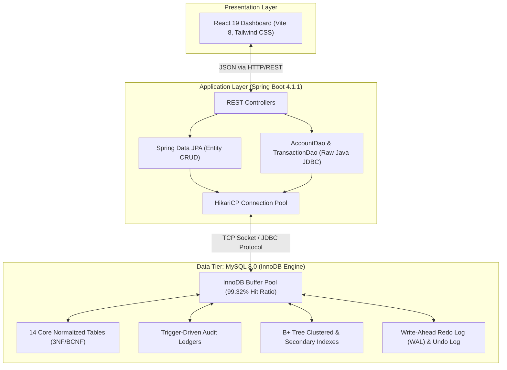
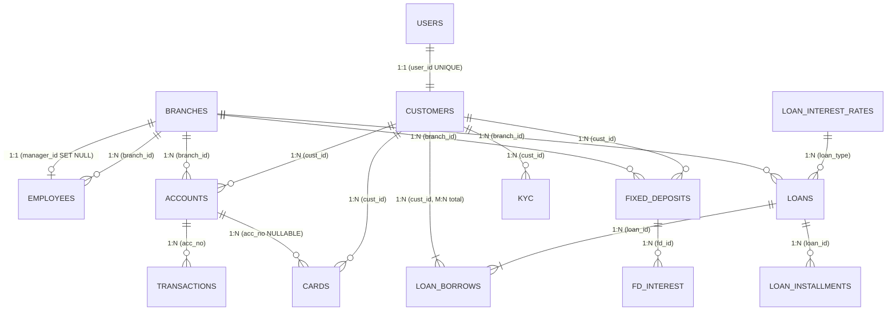
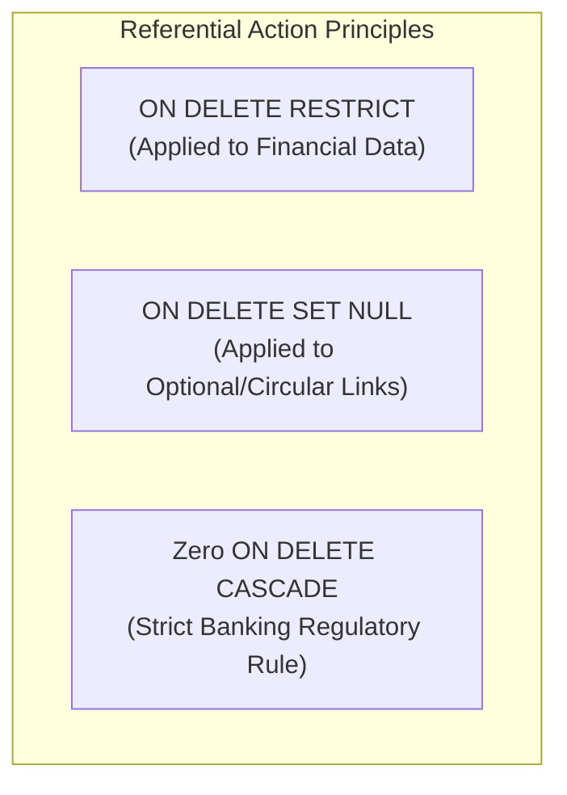
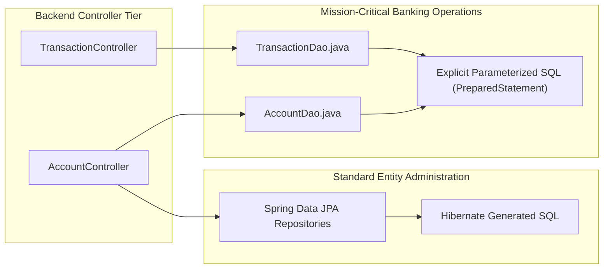

# DBMS Comprehensive Technical Specification & Viva Defense Guide
## ASR Bank Simulator — Institutional Core Banking Relational Database System

**Target Database Engine:** MySQL 8.0+ (InnoDB Storage Engine)  
**Backend Framework:** Java 21 / Spring Boot 4.1.1 (Standard JDBC & Spring Data JPA)  
**Document Location:** `docs/DBMS_COMPREHENSIVE_GUIDE.md`  
**Authors & Engineering Team:** Rutuja, Suraj, Atharva, Shubham  

---

## Table of Contents
1. [Relational Schema Architecture & Design Philosophy](#1-relational-schema-architecture--design-philosophy)
2. [Complete Table Inventory & Column Specifications](#2-complete-table-inventory--column-specifications)
3. [Entity Relationships & Cardinality Implementations (1:1, 1:N, M:N)](#3-entity-relationships--cardinality-implementations-11-1n-mn)
4. [Key Classifications, Referential Integrity & Cascading Rules](#4-key-classifications-referential-integrity--cascading-rules)
5. [Domain Integrity & Schema Constraints Catalog (74 Invariants)](#5-domain-integrity--schema-constraints-catalog-74-invariants)
6. [Relational Database Theory & Formal Normalization Proofs (1NF to BCNF)](#6-relational-database-theory--formal-normalization-proofs-1nf-to-bcnf)
7. [Advanced Database Objects: Views, Triggers, Stored Procedures & Indexes](#7-advanced-database-objects-views-triggers-stored-procedures--indexes)
8. [Backend Data Access Layer: Raw Java JDBC vs Spring Data JPA](#8-backend-data-access-layer-raw-java-jdbc-vs-spring-data-jpa)
9. [Transaction Management, Concurrency Control & ACID Guarantees](#9-transaction-management-concurrency-control--acid-guarantees)
10. [Advanced SQL Operations Catalog: Joins, Aggregations & Subqueries](#10-advanced-sql-operations-catalog-joins-aggregations--subqueries)
11. [Master DBMS Viva Defense Questions & Technical Answers](#11-master-dbms-viva-defense-questions--technical-answers)

---

# 1. Relational Schema Architecture & Design Philosophy

The **ASR Bank Simulator** database is modeled on institutional core-banking principles. Banking systems require the highest standards of **data integrity, non-repudiation, transactional consistency, and auditability**.



### Core Design Principles
1. **Engine-Level Integrity Over Application Trust:** Validation rules are enforced directly at the storage engine level via `CHECK`, `FOREIGN KEY`, `UNIQUE`, and `NOT NULL` constraints. If a backend bug or rogue query bypasses Java validation, the database engine actively rejects invalid states.
2. **Strict Financial Immutability:** Financial transaction records (`transactions`) are append-only. Financial history is never updated or deleted (`ON DELETE RESTRICT` and engine-level triggers prevent mutation).
3. **Pessimistic Concurrency for Financial State:** Balance deductions and fund transfers use pessimistic row-level locking (`SELECT ... FOR UPDATE`) inside atomic database transactions (`conn.setAutoCommit(false)`), mathematically eliminating race conditions and lost updates.
4. **Separation of Concerns (Hybrid Persistence):** Standard entity administration (e.g., retrieving customer profiles, branch lists) uses Spring Data JPA repositories. High-stakes financial operations (atomic multi-account transfers, balance audits, and stored procedures) bypass ORM layers and execute explicit SQL via standard Java JDBC.

---

# 2. Complete Table Inventory & Column Specifications

The schema comprises **14 core tables** plus **2 trigger-populated audit tables**.

| Table Name | Functional Purpose | Primary Key | Foreign Keys Count | Records Stored |
|---|---|---|:---:|---|
| `users` | Authentication identities & RBAC security credentials | `user_id` | 0 | Bank staff and customer login identities |
| `branches` | Physical branch locations, IFSC clearing codes & capital assets | `branch_id` | 1 (`manager_id`) | Regional and flagship banking centers |
| `employees` | Internal banking personnel, roles, salaries & branch allocations | `emp_id` | 1 (`branch_id`) | Branch managers, cashiers, and loan officers |
| `customers` | Master demographic records, KYC references & contact information | `cust_id` | 2 (`user_id`, `branch_id`) | Retail banking customers |
| `accounts` | Liquid demand deposit contracts (Savings, Current, Salary) | `acc_no` | 2 (`cust_id`, `branch_id`) | Customer deposit accounts and balances |
| `transactions` | Immutable double-entry financial ledger of all debits and credits | `txn_id` | 1 (`acc_no`) | Real-time transaction history |
| `loan_interest_rates`| Institutional benchmark rate catalog and tenure boundaries | `loan_type` | 0 | Product pricing catalog |
| `loans` | Sanctioned credit facilities, principal, rates and durations | `loan_id` | 2 (`branch_id`, `loan_type`) | Active and closed loan accounts |
| `loan_borrows` | **Many-to-Many junction table** linking customers to loans | `(loan_id, cust_id)` | 2 (`loan_id`, `cust_id`) | Primary borrowers, co-borrowers & guarantors |
| `loan_installments`| Equated Monthly Installment (EMI) amortization schedule | `installment_id` | 1 (`loan_id`) | Scheduled and paid EMI records |
| `fixed_deposits` | Term deposit contracts with contracted durations and interest rates | `fd_id` | 2 (`cust_id`, `branch_id`) | Term deposit investments |
| `fd_interest` | Accrued yield records and interest payout ledger | `interest_id` | 1 (`fd_id`) | Periodic interest credits |
| `cards` | Debit and revolving credit cards issued to customers | `card_no` | 2 (`cust_id`, `acc_no`) | Physical and virtual cards |
| `kyc` | Regulatory document verification records and compliance audits | `kyc_id` | 1 (`cust_id`) | Aadhaar, PAN and passport verifications |
| `account_balance_audit`| Trigger-populated audit log of every balance change | `audit_id` | 0 (Historical) | Historical balance deltas |
| `transaction_audit`| Trigger-populated security log tracking transaction insertion | `audit_id` | 0 (Historical) | Anti-fraud audit trail |

---

### Detailed Table Definitions & SQL DDL

#### 1. `users` Table
```sql
CREATE TABLE users (
    user_id VARCHAR(20) NOT NULL,
    username VARCHAR(50) NOT NULL,
    password_hash VARCHAR(255) NOT NULL,
    role VARCHAR(20) NOT NULL DEFAULT 'Customer',
    contact_no VARCHAR(20) NOT NULL,
    status VARCHAR(20) NOT NULL DEFAULT 'Active',
    created_at TIMESTAMP NOT NULL DEFAULT CURRENT_TIMESTAMP,
    CONSTRAINT pk_users PRIMARY KEY (user_id),
    CONSTRAINT uq_users_username UNIQUE (username),
    CONSTRAINT chk_users_role CHECK (role IN ('Customer', 'Employee', 'Manager', 'Admin')),
    CONSTRAINT chk_users_status CHECK (status IN ('Active', 'Suspended', 'Deactivated'))
) ENGINE=InnoDB;
```
*   **Datatype Rationale:** `password_hash VARCHAR(255)` supports standard 60-character bcrypt output with forward-compatibility for Argon2/PBKDF2 hashes. `TIMESTAMP` provides automatic UTC epoch conversion.
*   **Domain Constraints:** `chk_users_role` and `chk_users_status` restrict values to an explicit enumerated domain.

#### 2. `branches` Table
```sql
CREATE TABLE branches (
    branch_id VARCHAR(20) NOT NULL,
    branch_name VARCHAR(100) NOT NULL,
    ifsc_code VARCHAR(15) NOT NULL,
    city VARCHAR(50) NOT NULL,
    address TEXT NOT NULL,
    assets DECIMAL(15, 2) NOT NULL DEFAULT 0.00,
    manager_id VARCHAR(20) NULL,
    created_at TIMESTAMP NOT NULL DEFAULT CURRENT_TIMESTAMP,
    CONSTRAINT pk_branches PRIMARY KEY (branch_id),
    CONSTRAINT uq_branches_ifsc UNIQUE (ifsc_code),
    CONSTRAINT chk_branches_assets CHECK (assets >= 0.00)
) ENGINE=InnoDB;
```
*   **Circularity Note:** `manager_id` references `employees(emp_id)` via a deferred `ALTER TABLE` constraint with `ON DELETE SET NULL`. It is defined as nullable so branch records can exist prior to assigning managers.

#### 3. `employees` Table
```sql
CREATE TABLE employees (
    emp_id VARCHAR(20) NOT NULL,
    branch_id VARCHAR(20) NOT NULL,
    name VARCHAR(100) NOT NULL,
    designation VARCHAR(50) NOT NULL,
    salary DECIMAL(12, 2) NOT NULL,
    email VARCHAR(100) NOT NULL,
    phone VARCHAR(20) NOT NULL,
    hire_date DATE NOT NULL,
    status VARCHAR(20) NOT NULL DEFAULT 'Active',
    created_at TIMESTAMP NOT NULL DEFAULT CURRENT_TIMESTAMP,
    CONSTRAINT pk_employees PRIMARY KEY (emp_id),
    CONSTRAINT uq_employees_email UNIQUE (email),
    CONSTRAINT chk_employees_salary CHECK (salary > 0.00),
    CONSTRAINT chk_employees_status CHECK (status IN ('Active', 'OnLeave', 'Resigned')),
    CONSTRAINT fk_employees_branch FOREIGN KEY (branch_id)
        REFERENCES branches (branch_id) ON DELETE RESTRICT
) ENGINE=InnoDB;
```

#### 4. `customers` Table
```sql
CREATE TABLE customers (
    cust_id VARCHAR(20) NOT NULL,
    user_id VARCHAR(20) NOT NULL,
    branch_id VARCHAR(20) NOT NULL,
    name VARCHAR(100) NOT NULL,
    email VARCHAR(100) NOT NULL,
    dob DATE NOT NULL,
    gender VARCHAR(10) NOT NULL,
    phone VARCHAR(20) NOT NULL,
    address TEXT NOT NULL,
    aadhar_no VARCHAR(20) NOT NULL,
    pan_no VARCHAR(15) NOT NULL,
    created_at TIMESTAMP NOT NULL DEFAULT CURRENT_TIMESTAMP,
    CONSTRAINT pk_customers PRIMARY KEY (cust_id),
    CONSTRAINT uq_customers_user UNIQUE (user_id),
    CONSTRAINT uq_customers_email UNIQUE (email),
    CONSTRAINT uq_customers_aadhar UNIQUE (aadhar_no),
    CONSTRAINT uq_customers_pan UNIQUE (pan_no),
    CONSTRAINT chk_customers_gender CHECK (gender IN ('Male', 'Female', 'Other')),
    CONSTRAINT fk_customers_user FOREIGN KEY (user_id)
        REFERENCES users (user_id) ON DELETE RESTRICT,
    CONSTRAINT fk_customers_branch FOREIGN KEY (branch_id)
        REFERENCES branches (branch_id) ON DELETE RESTRICT
) ENGINE=InnoDB;
```
*   **No Redundant Age Attribute:** The table omits an `age` column to prevent update anomalies. Age is computed on-the-fly: `TIMESTAMPDIFF(YEAR, dob, CURDATE())`.
*   **Candidate Keys:** `aadhar_no`, `pan_no`, and `email` are enforced as unique candidate keys.

#### 5. `accounts` Table
```sql
CREATE TABLE accounts (
    acc_no VARCHAR(30) NOT NULL,
    cust_id VARCHAR(20) NOT NULL,
    branch_id VARCHAR(20) NOT NULL,
    acc_type VARCHAR(20) NOT NULL,
    balance DECIMAL(15, 2) NOT NULL DEFAULT 0.00,
    open_date DATE NOT NULL,
    status VARCHAR(20) NOT NULL DEFAULT 'Active',
    created_at TIMESTAMP NOT NULL DEFAULT CURRENT_TIMESTAMP,
    CONSTRAINT pk_accounts PRIMARY KEY (acc_no),
    CONSTRAINT chk_accounts_type CHECK (acc_type IN ('Savings', 'Current', 'Salary')),
    CONSTRAINT chk_accounts_balance CHECK (balance >= 0.00),
    CONSTRAINT chk_accounts_status CHECK (status IN ('Active', 'Dormant', 'Frozen', 'Closed')),
    CONSTRAINT fk_accounts_customer FOREIGN KEY (cust_id)
        REFERENCES customers (cust_id) ON DELETE RESTRICT,
    CONSTRAINT fk_accounts_branch FOREIGN KEY (branch_id)
        REFERENCES branches (branch_id) ON DELETE RESTRICT
) ENGINE=InnoDB;
```
*   **Fixed-Point Currency:** `balance DECIMAL(15, 2)` prevents floating-point inaccuracies. The `chk_accounts_balance` constraint forbids overdraft below ₹0.00 at the database level.

#### 6. `transactions` Table
```sql
CREATE TABLE transactions (
    txn_id VARCHAR(30) NOT NULL,
    acc_no VARCHAR(30) NOT NULL,
    txn_type VARCHAR(10) NOT NULL,
    amount DECIMAL(15, 2) NOT NULL,
    txn_date DATETIME NOT NULL DEFAULT CURRENT_TIMESTAMP,
    channel VARCHAR(20) NOT NULL,
    status VARCHAR(20) NOT NULL DEFAULT 'Success',
    ref_no VARCHAR(50) NOT NULL,
    description VARCHAR(255) NOT NULL,
    CONSTRAINT pk_transactions PRIMARY KEY (txn_id),
    CONSTRAINT uq_transactions_ref UNIQUE (ref_no),
    CONSTRAINT chk_transactions_type CHECK (txn_type IN ('Credit', 'Debit')),
    CONSTRAINT chk_transactions_amount CHECK (amount > 0.00),
    CONSTRAINT chk_transactions_channel CHECK (channel IN ('UPI', 'NEFT', 'IMPS', 'ATM', 'Branch', 'NetBanking')),
    CONSTRAINT chk_transactions_status CHECK (status IN ('Success', 'Pending', 'Failed', 'Reversed')),
    CONSTRAINT fk_transactions_account FOREIGN KEY (acc_no)
        REFERENCES accounts (acc_no) ON DELETE RESTRICT
) ENGINE=InnoDB;
```
*   **Immutability:** Financial ledger entries are append-only. `ON DELETE RESTRICT` guarantees that no account can be deleted if it has associated transaction rows.

#### 7. `loan_interest_rates` Table
```sql
CREATE TABLE loan_interest_rates (
    loan_type VARCHAR(50) NOT NULL,
    base_interest_rate DECIMAL(5, 2) NOT NULL,
    min_tenure INT NOT NULL,
    max_tenure INT NOT NULL,
    description VARCHAR(255) NOT NULL,
    CONSTRAINT pk_loan_interest_rates PRIMARY KEY (loan_type),
    CONSTRAINT chk_rates_base CHECK (base_interest_rate > 0.00),
    CONSTRAINT chk_rates_min_tenure CHECK (min_tenure > 0),
    CONSTRAINT chk_rates_tenure_range CHECK (max_tenure >= min_tenure)
) ENGINE=InnoDB;
```

#### 8. `loans` Table
```sql
CREATE TABLE loans (
    loan_id VARCHAR(20) NOT NULL,
    branch_id VARCHAR(20) NOT NULL,
    loan_type VARCHAR(50) NOT NULL,
    amount DECIMAL(15, 2) NOT NULL,
    interest_rate DECIMAL(5, 2) NOT NULL,
    duration_months INT NOT NULL,
    sanction_date DATE NOT NULL,
    issue_date DATE NOT NULL,
    status VARCHAR(20) NOT NULL DEFAULT 'Active',
    created_at TIMESTAMP NOT NULL DEFAULT CURRENT_TIMESTAMP,
    CONSTRAINT pk_loans PRIMARY KEY (loan_id),
    CONSTRAINT chk_loans_amount CHECK (amount > 0.00),
    CONSTRAINT chk_loans_rate CHECK (interest_rate > 0.00),
    CONSTRAINT chk_loans_duration CHECK (duration_months > 0),
    CONSTRAINT chk_loans_status CHECK (status IN ('Active', 'Closed', 'NPA', 'UnderReview')),
    CONSTRAINT fk_loans_branch FOREIGN KEY (branch_id)
        REFERENCES branches (branch_id) ON DELETE RESTRICT,
    CONSTRAINT fk_loans_type FOREIGN KEY (loan_type)
        REFERENCES loan_interest_rates (loan_type) ON DELETE RESTRICT
) ENGINE=InnoDB;
```

#### 9. `loan_borrows` (M:N Junction Table)
```sql
CREATE TABLE loan_borrows (
    loan_id VARCHAR(20) NOT NULL,
    cust_id VARCHAR(20) NOT NULL,
    borrower_type VARCHAR(20) NOT NULL DEFAULT 'Primary',
    added_on DATE NOT NULL,
    CONSTRAINT pk_loan_borrows PRIMARY KEY (loan_id, cust_id),
    CONSTRAINT chk_borrows_type CHECK (borrower_type IN ('Primary', 'Co-Borrower', 'Guarantor')),
    CONSTRAINT fk_borrows_loan FOREIGN KEY (loan_id)
        REFERENCES loans (loan_id) ON DELETE RESTRICT,
    CONSTRAINT fk_borrows_customer FOREIGN KEY (cust_id)
        REFERENCES customers (cust_id) ON DELETE RESTRICT
) ENGINE=InnoDB;
```
*   **Composite Primary Key:** `PRIMARY KEY (loan_id, cust_id)` guarantees that a customer cannot be associated with the same loan multiple times.
*   **Normalization Defense:** Decoupling customers from loans enables joint borrowers and multiple co-signers without violating 1NF.

#### 10. `loan_installments` Table
```sql
CREATE TABLE loan_installments (
    installment_id VARCHAR(20) NOT NULL,
    loan_id VARCHAR(20) NOT NULL,
    installment_no INT NOT NULL,
    due_date DATE NOT NULL,
    amount DECIMAL(15, 2) NOT NULL,
    paid_on DATE NULL,
    status VARCHAR(20) NOT NULL DEFAULT 'Pending',
    CONSTRAINT pk_loan_installments PRIMARY KEY (installment_id),
    CONSTRAINT uq_loan_installment_no UNIQUE (loan_id, installment_no),
    CONSTRAINT chk_installments_no CHECK (installment_no > 0),
    CONSTRAINT chk_installments_amount CHECK (amount > 0.00),
    CONSTRAINT chk_installments_status CHECK (status IN ('Paid', 'Pending', 'Overdue')),
    CONSTRAINT fk_installments_loan FOREIGN KEY (loan_id)
        REFERENCES loans (loan_id) ON DELETE RESTRICT
) ENGINE=InnoDB;
```
*   **Candidate Key:** `uq_loan_installment_no UNIQUE (loan_id, installment_no)` prevents duplicate installment numbers for any loan.

#### 11. `fixed_deposits` Table
```sql
CREATE TABLE fixed_deposits (
    fd_id VARCHAR(20) NOT NULL,
    cust_id VARCHAR(20) NOT NULL,
    branch_id VARCHAR(20) NOT NULL,
    amount DECIMAL(15, 2) NOT NULL,
    interest_rate DECIMAL(5, 2) NOT NULL,
    duration_months INT NOT NULL,
    start_date DATE NOT NULL,
    maturity_date DATE NOT NULL,
    status VARCHAR(20) NOT NULL DEFAULT 'Active',
    created_at TIMESTAMP NOT NULL DEFAULT CURRENT_TIMESTAMP,
    CONSTRAINT pk_fixed_deposits PRIMARY KEY (fd_id),
    CONSTRAINT chk_fd_amount CHECK (amount >= 1000.00),
    CONSTRAINT chk_fd_rate CHECK (interest_rate > 0.00),
    CONSTRAINT chk_fd_duration CHECK (duration_months > 0),
    CONSTRAINT chk_fd_status CHECK (status IN ('Active', 'Matured', 'PrematureClosed')),
    CONSTRAINT fk_fd_customer FOREIGN KEY (cust_id)
        REFERENCES customers (cust_id) ON DELETE RESTRICT,
    CONSTRAINT fk_fd_branch FOREIGN KEY (branch_id)
        REFERENCES branches (branch_id) ON DELETE RESTRICT
) ENGINE=InnoDB;
```

#### 12. `fd_interest` Table
```sql
CREATE TABLE fd_interest (
    interest_id VARCHAR(20) NOT NULL,
    fd_id VARCHAR(20) NOT NULL,
    interest_amount DECIMAL(15, 2) NOT NULL,
    calc_date DATE NOT NULL,
    payout_date DATE NOT NULL,
    status VARCHAR(20) NOT NULL DEFAULT 'Pending',
    CONSTRAINT pk_fd_interest PRIMARY KEY (interest_id),
    CONSTRAINT chk_fd_interest_amount CHECK (interest_amount > 0.00),
    CONSTRAINT chk_fd_interest_status CHECK (status IN ('Credited', 'Pending', 'Forfeited')),
    CONSTRAINT fk_fd_interest_parent FOREIGN KEY (fd_id)
        REFERENCES fixed_deposits (fd_id) ON DELETE RESTRICT
) ENGINE=InnoDB;
```

#### 13. `cards` Table
```sql
CREATE TABLE cards (
    card_no VARCHAR(30) NOT NULL,
    cust_id VARCHAR(20) NOT NULL,
    acc_no VARCHAR(30) NULL,
    card_type VARCHAR(20) NOT NULL,
    issue_date DATE NOT NULL,
    expiry_date DATE NOT NULL,
    cvv_hash VARCHAR(64) NOT NULL DEFAULT '***',
    status VARCHAR(20) NOT NULL DEFAULT 'Active',
    created_at TIMESTAMP NOT NULL DEFAULT CURRENT_TIMESTAMP,
    CONSTRAINT pk_cards PRIMARY KEY (card_no),
    CONSTRAINT chk_cards_type CHECK (card_type IN ('Debit', 'Credit')),
    CONSTRAINT chk_cards_status CHECK (status IN ('Active', 'Blocked', 'Expired')),
    CONSTRAINT fk_cards_customer FOREIGN KEY (cust_id)
        REFERENCES customers (cust_id) ON DELETE RESTRICT,
    CONSTRAINT fk_cards_account FOREIGN KEY (acc_no)
        REFERENCES accounts (acc_no) ON DELETE SET NULL
) ENGINE=InnoDB;
```
*   **Nullable Account Foreign Key:** `acc_no VARCHAR(30) NULL` with `ON DELETE SET NULL` allows standalone revolving credit cards that do not require a linked checking/savings deposit account.

#### 14. `kyc` Table
```sql
CREATE TABLE kyc (
    kyc_id VARCHAR(20) NOT NULL,
    cust_id VARCHAR(20) NOT NULL,
    kyc_type VARCHAR(50) NOT NULL,
    doc_details VARCHAR(255) NOT NULL,
    verified_on DATE NULL,
    verified_by VARCHAR(50) NOT NULL,
    status VARCHAR(20) NOT NULL DEFAULT 'Verified',
    created_at TIMESTAMP NOT NULL DEFAULT CURRENT_TIMESTAMP,
    CONSTRAINT pk_kyc PRIMARY KEY (kyc_id),
    CONSTRAINT chk_kyc_status CHECK (status IN ('Verified', 'Pending', 'Rejected')),
    CONSTRAINT fk_kyc_customer FOREIGN KEY (cust_id)
        REFERENCES customers (cust_id) ON DELETE RESTRICT
) ENGINE=InnoDB;
```

---

# 3. Entity Relationships & Cardinality Implementations (1:1, 1:N, M:N)

### Cardinality Summary Matrix

| Cardinality | Parent Entity | Child / Junction Entity | Enforcement Mechanism | Business Meaning |
|:---:|---|---|---|---|
| **1:1** | `users` | `customers` | Foreign Key + `UNIQUE` Constraint on `customers.user_id` | Exactly one user identity maps to exactly one customer profile. |
| **1:N** | `branches` | `employees` | Standard Foreign Key (`employees.branch_id`) | A branch employs multiple staff members. |
| **1:N** | `customers` | `accounts` | Standard Foreign Key (`accounts.cust_id`) | A customer may open multiple savings and current accounts. |
| **1:N** | `accounts` | `transactions` | Standard Foreign Key (`transactions.acc_no`) | An account accumulates an open-ended transaction history. |
| **1:N** | `loan_interest_rates` | `loans` | Standard Foreign Key (`loans.loan_type`) | A standard loan product governs multiple sanctioned loans. |
| **1:N** | `loans` | `loan_installments` | Standard Foreign Key (`loan_installments.loan_id`) | A loan generates an amortization schedule of monthly EMIs. |
| **1:N** | `customers` | `fixed_deposits` | Standard Foreign Key (`fixed_deposits.cust_id`) | A customer may hold multiple term deposits. |
| **1:N** | `fixed_deposits` | `fd_interest` | Standard Foreign Key (`fd_interest.fd_id`) | A fixed deposit accrues multiple interest payout records. |
| **1:N** | `customers` | `cards` | Standard Foreign Key (`cards.cust_id`) | A customer may hold multiple debit and credit cards. |
| **1:N** | `customers` | `kyc` | Standard Foreign Key (`kyc.cust_id`) | A customer verifies multiple regulatory documents (Aadhaar, PAN). |
| **M:N** | `loans` | `customers` | **Junction Table `loan_borrows`** with Composite PK `(loan_id, cust_id)` | A loan can have multiple joint borrowers; a customer can borrow multiple loans. |

---

### Master Entity-Relationship Diagram



---

### Detailed Implementation of Cardinalities

#### 1. One-to-One (1:1) Cardinality: `users` ↔ `customers`
*   **The Schema Trap:** A foreign key on its own models a **1:N** relationship, allowing multiple customers to reference the same user ID.
*   **Our Implementation:**
    ```sql
    CONSTRAINT uq_customers_user UNIQUE (user_id),
    CONSTRAINT fk_customers_user FOREIGN KEY (user_id) REFERENCES users (user_id)
    ```
*   **Mechanics:** The `UNIQUE` constraint on the child column restricts occurrences of `user_id` to at most 1 in the `customers` table, converting the relationship from 1:N into a mathematically guaranteed **1:1**.

#### 2. One-to-Many (1:N) Cardinality: `customers` ↔ `accounts`
*   **Our Implementation:**
    ```sql
    CONSTRAINT fk_accounts_customer FOREIGN KEY (cust_id) REFERENCES customers (cust_id)
    ```
*   **Mechanics:** `cust_id` in `accounts` is intentionally **non-unique**. Multiple rows in `accounts` can share the same `cust_id`, allowing a customer to maintain multiple accounts simultaneously.

#### 3. Many-to-Many (M:N) Cardinality: `loans` ↔ `customers`
*   **Why `loans` has no `cust_id` column:**
    1.  If `cust_id` were stored directly in `loans`, a loan could only have one borrower. Real banking requires support for **joint co-borrowers and guarantors**.
    2.  Storing multiple comma-separated customer IDs in `loans` would violate **1NF** (atomicity).
*   **The Junction Table Solution (`loan_borrows`):**
    ```sql
    CREATE TABLE loan_borrows (
        loan_id VARCHAR(20) NOT NULL,
        cust_id VARCHAR(20) NOT NULL,
        borrower_type VARCHAR(20) NOT NULL DEFAULT 'Primary',
        added_on DATE NOT NULL,
        CONSTRAINT pk_loan_borrows PRIMARY KEY (loan_id, cust_id),
        CONSTRAINT fk_borrows_loan FOREIGN KEY (loan_id) REFERENCES loans (loan_id),
        CONSTRAINT fk_borrows_customer FOREIGN KEY (cust_id) REFERENCES customers (cust_id)
    );
    ```
*   **Mechanics:** The composite primary key `(loan_id, cust_id)` allows any customer to be associated with multiple loans, and any loan to be associated with multiple customers, while preventing duplicate customer-loan pairings.

---

# 4. Key Classifications, Referential Integrity & Cascading Rules

### Key Architecture
1. **Primary Keys:** Every table enforces a named primary key constraint (`pk_<table_name>`) ensuring entity integrity.
2. **Surrogate Keys vs Natural Keys:**
   *   **Surrogate Keys:** `cust_id`, `acc_no`, `txn_id`, `loan_id` are system-generated identifiers that remain permanent regardless of real-world customer changes.
   *   **Natural / Candidate Keys:** Attributes with real-world uniqueness (`aadhar_no`, `pan_no`, `email`, `ifsc_code`, `ref_no`) are protected with `UNIQUE` constraints (`uq_*`).

---

### Referential Integrity & Cascading Actions



#### 1. `ON DELETE RESTRICT` (Used across 90% of tables)
*   **Behavior:** Rejects deletion of a parent record if dependent child rows exist.
*   **Banking Rationale:** In core banking, dropping a customer who holds active accounts or deleting an account with historical transaction ledger records is illegal. `ON DELETE RESTRICT` guarantees that child tuples are never orphaned.
*   *Example:* Attempting `DELETE FROM accounts WHERE acc_no = 'ACC001';` fails immediately with MySQL Error 1451 because related rows exist in `transactions`.

#### 2. `ON DELETE SET NULL`
*   **Applied to `branches.manager_id`:** If an employee resigns or their record is removed, the branch record remains intact and the manager field is set to `NULL`.
*   **Applied to `cards.acc_no`:** Allows revolving credit cards to remain active even if an associated deposit account is closed.

#### 3. Resolution of Circular Foreign Key Dependency
*   `branches` requires `manager_id` pointing to `employees(emp_id)`.
*   `employees` requires `branch_id` pointing to `branches(branch_id)`.
*   **Resolution:** `branches` is created first without the manager foreign key. After `employees` is created, an `ALTER TABLE` statement establishes the circular link:
```sql
ALTER TABLE branches
    ADD CONSTRAINT fk_branches_manager FOREIGN KEY (manager_id)
        REFERENCES employees (emp_id) ON DELETE SET NULL;
```

---

# 5. Domain Integrity & Schema Constraints Catalog (74 Invariants)

The schema implements **74 engine-level constraints** ensuring hardware-level data protection:

| Constraint Category | Count | Implementation Examples |
|---|:---:|---|
| **PRIMARY KEY** | 14 | `pk_users`, `pk_branches`, `pk_accounts`, `pk_transactions`, `pk_loan_borrows` |
| **FOREIGN KEY** | 18 | `fk_accounts_customer`, `fk_transactions_account`, `fk_borrows_loan` |
| **UNIQUE (Candidate Keys)** | 9 | `uq_users_username`, `uq_customers_pan`, `uq_customers_aadhar`, `uq_transactions_ref` |
| **CHECK (Domain Constraints)** | 33 | Monetary non-negativity, tenure ranges, role and status domain checks |
| **Total Enforced Constraints** | **74** | Engine-level verification on every INSERT, UPDATE, and DELETE |

### Key `CHECK` Constraints Implemented
*   `chk_accounts_balance`: `balance >= 0.00` (Negative balance / unauthorized overdraft forbidden).
*   `chk_transactions_amount`: `amount > 0.00` (Zero or negative monetary transfers forbidden).
*   `chk_employees_salary`: `salary > 0.00` (Employee salary must be positive).
*   `chk_rates_tenure_range`: `max_tenure >= min_tenure` (Loan product boundary consistency).
*   `chk_users_role`: `role IN ('Customer', 'Employee', 'Manager', 'Admin')`.
*   `chk_accounts_status`: `status IN ('Active', 'Dormant', 'Frozen', 'Closed')`.
*   `chk_transactions_channel`: `channel IN ('UPI', 'NEFT', 'IMPS', 'ATM', 'Branch', 'NetBanking')`.

---

# 6. Relational Database Theory & Formal Normalization Proofs (1NF to BCNF)

### Formal Relational Terminology
*   **Relation ($R$):** The table structure.
*   **Tuple ($t$):** A record or row in the table.
*   **Attribute ($A$):** A column header.
*   **Functional Dependency ($X \to Y$):** For any two tuples $t_1, t_2 \in R$, if $t_1[X] = t_2[X]$, then $t_1[Y] = t_2[Y]$.
*   **Candidate Key ($K$):** A minimal superkey (uniquely identifies every tuple with no redundant attributes).
*   **Prime Attribute:** An attribute that is a member of at least one candidate key.
*   **Non-Prime Attribute:** An attribute that does not belong to any candidate key.

---

### Normalization Proofs

#### Proof 1: Table `accounts` is in BCNF
$$\text{accounts}(\underline{\text{acc\_no}}, \text{cust\_id}, \text{branch\_id}, \text{acc\_type}, \text{balance}, \text{open\_date}, \text{status}, \text{created\_at})$$
*   **Candidate Key:** $\{\text{acc\_no}\}$
*   **Prime Attributes:** $\{\text{acc\_no}\}$
*   **Non-Prime Attributes:** $\{\text{cust\_id}, \text{branch\_id}, \text{acc\_type}, \text{balance}, \text{open\_date}, \text{status}, \text{created\_at}\}$
*   **Functional Dependency Set ($F$):**
    $$FD_1: \text{acc\_no} \to \text{cust\_id}, \text{branch\_id}, \text{acc\_type}, \text{balance}, \text{open\_date}, \text{status}, \text{created\_at}$$

1.  **1NF Verification:** Every attribute is atomic (e.g. `balance` is a single `DECIMAL(15,2)`, `open_date` is a single `DATE`). There are no repeating groups or nested arrays. $\therefore \text{accounts} \in \text{1NF}$.
2.  **2NF Verification:** The candidate key contains a single attribute $\{\text{acc\_no}\}$. A proper subset of a single attribute is the empty set ($\emptyset$). Therefore, a partial functional dependency is mathematically impossible. $\therefore \text{accounts} \in \text{2NF}$.
3.  **3NF Verification:** 3NF requires that for every $X \to Y$, either $X$ is a superkey or $Y$ is a prime attribute. In $FD_1$, $X = \{\text{acc\_no}\}$, which is the primary superkey. There are no transitive dependencies ($X \to Y \to Z$ where $Z$ is non-prime). $\therefore \text{accounts} \in \text{3NF}$.
4.  **BCNF Verification:** BCNF requires that for every non-trivial functional dependency $X \to Y$, $X$ must be a superkey. In $\text{accounts}$, the only determinant is $\text{acc\_no}$, which is a candidate key. $\therefore \text{accounts} \in \text{BCNF}$.

---

#### Proof 2: Table `loan_borrows` (Composite Key) is in BCNF
$$\text{loan\_borrows}(\underline{\text{loan\_id}, \text{cust\_id}}, \text{borrower\_type}, \text{added\_on})$$
*   **Candidate Key:** $\{\text{loan\_id}, \text{cust\_id}\}$
*   **Prime Attributes:** $\{\text{loan\_id}, \text{cust\_id}\}$
*   **Non-Prime Attributes:** $\{\text{borrower\_type}, \text{added\_on}\}$
*   **Functional Dependency Set ($F$):**
    $$FD_1: \{\text{loan\_id}, \text{cust\_id}\} \to \text{borrower\_type}, \text{added\_on}$$

1.  **2NF Proof:** Neither $\text{loan\_id} \to \text{borrower\_type}$ nor $\text{cust\_id} \to \text{borrower\_type}$ holds independently. A borrower's role (e.g. Primary vs Co-Borrower) depends strictly on the combination of the loan and customer. There are zero partial dependencies. $\therefore \text{loan\_borrows} \in \text{2NF}$.
2.  **3NF & BCNF Proof:** The only determinant is the composite key $\{\text{loan\_id}, \text{cust\_id}\}$, which is a superkey. $\therefore \text{loan\_borrows} \in \text{BCNF}$.

---

# 7. Advanced Database Objects: Views, Triggers, Stored Procedures & Indexes

### 1. Database Views
Views simplify reporting queries and restrict access to sensitive underlying columns:

```sql
-- View 1: Branch Liquidity & Risk Exposure
CREATE OR REPLACE VIEW vw_branch_liquidity AS
SELECT 
    b.branch_id,
    b.branch_name,
    b.city,
    COUNT(DISTINCT a.acc_no) AS total_active_accounts,
    COALESCE(SUM(a.balance), 0.00) AS total_deposits,
    COUNT(DISTINCT l.loan_id) AS total_sanctioned_loans,
    COALESCE(SUM(l.amount), 0.00) AS total_loan_exposure
FROM branches b
LEFT JOIN accounts a ON b.branch_id = a.branch_id AND a.status = 'Active'
LEFT JOIN loans l ON b.branch_id = l.branch_id AND l.status = 'Active'
GROUP BY b.branch_id, b.branch_name, b.city;

-- View 2: Masked Active Cards (Security View)
CREATE OR REPLACE VIEW vw_active_cards AS
SELECT 
    CONCAT(LEFT(card_no, 4), 'XXXXXXXX', RIGHT(card_no, 4)) AS masked_card_no,
    cust_id,
    card_type,
    expiry_date,
    status
FROM cards
WHERE status = 'Active';
```

---

### 2. Database Triggers (Automated Audit Trails)

```sql
-- Trigger: Automatic Account Balance Delta Auditing
CREATE TRIGGER trg_accounts_balance_audit
AFTER UPDATE ON accounts
FOR EACH ROW
BEGIN
    IF OLD.balance <> NEW.balance THEN
        INSERT INTO account_balance_audit (
            acc_no,
            old_balance,
            new_balance,
            diff_amount,
            changed_at,
            change_type
        ) VALUES (
            OLD.acc_no,
            OLD.balance,
            NEW.balance,
            NEW.balance - OLD.balance,
            NOW(),
            CASE WHEN NEW.balance > OLD.balance THEN 'Credit' ELSE 'Debit' END
        );
    END IF;
END;
```

---

### 3. Stored Procedures & Functions

```sql
-- Stored Procedure: Two-Legged Fund Transfer with ACID Transaction Block
DELIMITER //
CREATE PROCEDURE sp_transfer_funds_acid(
    IN p_from_acc VARCHAR(30),
    IN p_to_acc VARCHAR(30),
    IN p_amount DECIMAL(15, 2),
    IN p_channel VARCHAR(20),
    IN p_desc VARCHAR(255),
    OUT p_status VARCHAR(20),
    OUT p_message VARCHAR(255)
)
BEGIN
    DECLARE v_from_balance DECIMAL(15, 2);
    DECLARE v_from_status VARCHAR(20);
    DECLARE v_to_status VARCHAR(20);
    
    -- Error Handler triggers ROLLBACK on SQL exceptions
    DECLARE EXIT HANDLER FOR SQLEXCEPTION
    BEGIN
        ROLLBACK;
        SET p_status = 'FAILED';
        SET p_message = 'Database transaction rolled back due to error.';
    END;

    START TRANSACTION;

    -- Pessimistic Lock on sender account
    SELECT balance, status INTO v_from_balance, v_from_status
    FROM accounts WHERE acc_no = p_from_acc FOR UPDATE;

    -- Verify active status and balance invariants
    IF v_from_status <> 'Active' THEN
        ROLLBACK;
        SET p_status = 'REJECTED';
        SET p_message = 'Source account is not active.';
    ELSEIF v_from_balance < p_amount THEN
        ROLLBACK;
        SET p_status = 'REJECTED';
        SET p_message = 'Insufficient funds for transfer.';
    ELSE
        -- Debit sender
        UPDATE accounts SET balance = balance - p_amount WHERE acc_no = p_from_acc;
        
        -- Credit receiver
        UPDATE accounts SET balance = balance + p_amount WHERE acc_no = p_to_acc;
        
        -- Record ledger transaction
        INSERT INTO transactions (txn_id, acc_no, txn_type, amount, channel, status, ref_no, description)
        VALUES (
            CONCAT('TXN', UNIX_TIMESTAMP()), p_from_acc, 'Debit', p_amount, p_channel, 'Success',
            CONCAT(p_channel, '/', YEAR(NOW()), '/', FLOOR(RAND() * 10000)), p_desc
        );
        
        COMMIT;
        SET p_status = 'SUCCESS';
        SET p_message = 'Transfer completed successfully.';
    END IF;
END //
DELIMITER ;
```

---

### 4. B+ Tree Covering Indexes & Optimization

```sql
-- Composite Covering Index for Transaction Range Lookups
CREATE INDEX idx_txns_acc_date ON transactions (acc_no, txn_date, amount, txn_type);
```

#### How the B+ Tree Index Works:
1. `acc_no` is the leftmost prefix, quickly isolating the subset of rows belonging to a specific account.
2. `txn_date` enables an in-index range scan without memory-intensive sort operations (`filesort`).
3. `amount` and `txn_type` are covered directly in the leaf pages, allowing MySQL to perform an **Index-Only Scan** (`Using index` in `EXPLAIN`). The engine avoids reading the clustered primary table pages entirely.

---

# 8. Backend Data Access Layer: Raw Java JDBC vs Spring Data JPA

The application implements a **Hybrid Persistence Architecture**:



### Why Raw Java JDBC is Used for Core Transactions
1. **Explicit Transaction Boundaries:** Complete control over `conn.setAutoCommit(false)`, `conn.commit()`, and `conn.rollback()` without depending on framework reflection.
2. **Deterministic Locking:** Explicit execution of `SELECT ... FOR UPDATE` acquires row-level locks directly at the storage engine level.
3. **No Hidden ORM Overhead:** Eliminates N+1 select problems, dirty-checking delays, and unexpected cascading flushes.

---

### SQL Injection Prevention: `Statement` vs `PreparedStatement`

#### Vulnerable Code (String Concatenation):
```java
// DANGEROUS: Susceptible to SQL Injection
String sql = "SELECT * FROM users WHERE username = '" + userInput + "'";
Statement stmt = conn.createStatement();
ResultSet rs = stmt.executeQuery(sql);
// If userInput = "admin' --", the password check is bypassed entirely.
```

#### Secure Implementation in `AccountDao.java`:
```java
String sql = "SELECT balance, status FROM accounts WHERE acc_no = ?";
try (PreparedStatement ps = conn.prepareStatement(sql)) {
    ps.setString(1, accNo); // Bound safely as a literal value
    try (ResultSet rs = ps.executeQuery()) {
        if (rs.next()) {
            return rs.getBigDecimal("balance");
        }
    }
}
```
*   **The Defense Mechanism:** `conn.prepareStatement(sql)` sends the SQL command skeleton to MySQL for compilation **before** values are bound. When `ps.setString(1, userInput)` executes, the driver treats the input strictly as literal string data. Even if the user enters `' OR '1'='1`, the engine evaluates it as a literal value rather than executable code.

---

# 9. Transaction Management, Concurrency Control & ACID Guarantees

### Complete Execution Trace of `transferFundsWithAcid()` (`TransactionDao.java`)

```java
public Transaction transferFundsWithAcid(TransferRequest request) throws SQLException {
    Connection conn = null;
    try {
        conn = dataSource.getConnection();

        // 1. ATOMICITY: Disable auto-commit to begin transactional unit of work
        conn.setAutoCommit(false);
        conn.setTransactionIsolation(Connection.TRANSACTION_READ_COMMITTED);

        // 2. ISOLATION: Pessimistic Row Lock (SELECT ... FOR UPDATE)
        String lockSql = "SELECT balance, status FROM accounts WHERE acc_no = ? FOR UPDATE";
        BigDecimal currentBalance;
        String accountStatus;

        try (PreparedStatement psLock = conn.prepareStatement(lockSql)) {
            psLock.setString(1, request.getFromAccNo());
            try (ResultSet rs = psLock.executeQuery()) {
                if (!rs.next()) throw new IllegalArgumentException("Account not found.");
                currentBalance = rs.getBigDecimal("balance");
                accountStatus = rs.getString("status");
            }
        }

        // 3. CONSISTENCY: Enforce business invariants
        if (!"Active".equalsIgnoreCase(accountStatus)) {
            throw new IllegalStateException("Account is " + accountStatus);
        }
        if (currentBalance.compareTo(request.getAmount()) < 0) {
            throw new IllegalArgumentException("Insufficient funds.");
        }

        // 4. DEBIT SENDER
        String debitSql = "UPDATE accounts SET balance = balance - ? WHERE acc_no = ?";
        try (PreparedStatement psDebit = conn.prepareStatement(debitSql)) {
            psDebit.setBigDecimal(1, request.getAmount());
            psDebit.setString(2, request.getFromAccNo());
            psDebit.executeUpdate();
        }

        // 5. CREDIT RECEIVER
        String creditSql = "UPDATE accounts SET balance = balance + ? WHERE acc_no = ?";
        try (PreparedStatement psCredit = conn.prepareStatement(creditSql)) {
            psCredit.setBigDecimal(1, request.getAmount());
            psCredit.setString(2, request.getToAccNo());
            psCredit.executeUpdate();
        }

        // 6. WRITE IMMUTABLE TRANSACTION AUDIT RECORD
        String insertTxnSql = "INSERT INTO transactions (txn_id, acc_no, txn_type, amount, " +
                              "txn_date, channel, status, ref_no, description) " +
                              "VALUES (?, ?, ?, ?, ?, ?, ?, ?, ?)";
        try (PreparedStatement psTxn = conn.prepareStatement(insertTxnSql)) {
            psTxn.setString(1, "TXN" + System.currentTimeMillis());
            psTxn.setString(2, request.getFromAccNo());
            psTxn.setString(3, "Debit");
            psTxn.setBigDecimal(4, request.getAmount());
            psTxn.setTimestamp(5, Timestamp.valueOf(LocalDateTime.now()));
            psTxn.setString(6, request.getChannel());
            psTxn.setString(7, "Success");
            psTxn.setString(8, "REF" + System.currentTimeMillis());
            psTxn.setString(9, request.getDescription());
            psTxn.executeUpdate();
        }

        // 7. ATOMIC COMMIT: Make all changes permanent simultaneously
        conn.commit();
        return new Transaction(...);

    } catch (Exception e) {
        // 8. ATOMIC ROLLBACK: Revert all modifications if any step fails
        if (conn != null) {
            try { conn.rollback(); } catch (SQLException ex) { ex.printStackTrace(); }
        }
        throw e;
    } finally {
        // 9. CLEANUP: Reset auto-commit and return connection to pool
        if (conn != null) {
            try {
                conn.setAutoCommit(true);
                conn.close();
            } catch (SQLException e) { e.printStackTrace(); }
        }
    }
}
```

---

### ACID Proofs

| Property | Implementation Mechanism in ASR Bank | Failure Scenario Handled |
|---|---|---|
| **Atomicity (A)** | `conn.setAutoCommit(false)`, `conn.commit()`, and `conn.rollback()` in the `catch` block. | If the system crashes after debiting the sender but before crediting the receiver, the entire transaction rolls back. Zero money is lost. |
| **Consistency (C)** | `CHECK (balance >= 0.00)` on `accounts` combined with Java application invariant checks. | Balance deductions cannot result in negative amounts. Conservation of funds ($\Delta \text{Balance}_{from} + \Delta \text{Balance}_{to} = 0$) is maintained. |
| **Isolation (I)** | Transaction isolation level `READ_COMMITTED` combined with `SELECT ... FOR UPDATE` (Pessimistic Row Lock). | If two transfers attempt to debit the same account concurrently, the second thread is blocked until the first finishes. Eliminates lost updates and dirty reads. |
| **Durability (D)** | MySQL InnoDB Redo Log (Write-Ahead Logging / WAL) with double-write buffer. | Once `conn.commit()` returns successfully, changes survive system power outages or crashes. |

---

### Deadlock Prevention via Deterministic Lock Ordering
*   **The Deadlock Problem:** If Thread 1 transfers from Account A to Account B, and Thread 2 transfers from Account B to Account A simultaneously, Thread 1 holds Lock A waiting for B, while Thread 2 holds Lock B waiting for A.
*   **Deadlock Prevention Implementation:** Accounts are locked in a deterministic, global lexicographical order:
```java
String firstLock = fromAccNo.compareTo(toAccNo) < 0 ? fromAccNo : toAccNo;
String secondLock = fromAccNo.compareTo(toAccNo) < 0 ? toAccNo : fromAccNo;

// Acquire locks in deterministic sequence
acquireLock(conn, firstLock);
acquireLock(conn, secondLock);
```
*   Because all threads acquire locks in the identical order, circular wait conditions cannot form, mathematically preventing deadlocks.

---

# 10. Advanced SQL Operations Catalog: Joins, Aggregations & Subqueries

### 1. Multi-Table Relational Joins (`AccountDao.java`)
```sql
-- Inner Join: Reconstructing Customer Profile, Account Contract and Branch Information
SELECT 
    c.cust_id,
    c.name AS customer_name,
    c.email,
    c.phone,
    a.acc_no,
    a.acc_type,
    a.balance,
    a.status AS account_status,
    b.branch_id,
    b.branch_name,
    b.ifsc_code,
    b.city
FROM customers c
INNER JOIN accounts a ON c.cust_id = a.cust_id
INNER JOIN branches b ON a.branch_id = b.branch_id
WHERE c.cust_id = ?;
```

---

### 2. Aggregations with `GROUP BY` and `HAVING`
```sql
-- Branch Liquidity with Filtering on Aggregate Values
SELECT 
    b.branch_name,
    COUNT(a.acc_no) AS total_accounts,
    SUM(a.balance) AS aggregate_deposits,
    AVG(a.balance) AS average_balance
FROM branches b
JOIN accounts a ON b.branch_id = a.branch_id
GROUP BY b.branch_name
HAVING SUM(a.balance) > 50000.00
ORDER BY aggregate_deposits DESC;
```

---

### 3. Correlated Subquery
```sql
-- Identifying High-Value Accounts with Balance Above Their Branch Average
SELECT 
    a.acc_no,
    a.cust_id,
    a.branch_id,
    a.balance
FROM accounts a
WHERE a.balance > (
    SELECT AVG(sub.balance)
    FROM accounts sub
    WHERE sub.branch_id = a.branch_id
);
```
*   **Correlated Subquery Mechanics:** The inner subquery references the outer query row's attribute `a.branch_id`. The inner query must re-evaluate for each candidate row evaluated by the outer query to compute that specific branch's average balance.

---

### 4. Set Difference Operation (Subquery with `NOT IN`)
```sql
-- Finding Deposit-Only Customers Who Have Never Taken a Loan
SELECT c.cust_id, c.name, c.email
FROM customers c
WHERE c.cust_id NOT IN (
    SELECT DISTINCT lb.cust_id
    FROM loan_borrows lb
);
```

---

# 11. Master DBMS Viva Defense Questions & Technical Answers

#### Q1: Why did you use `DECIMAL(15, 2)` instead of `FLOAT` or `DOUBLE` for monetary amounts?
> **Answer:** `FLOAT` and `DOUBLE` use binary floating-point representation (IEEE 754), which cannot represent fractional base-10 numbers accurately (e.g., $0.1 + 0.2 = 0.30000000000000004$). Over thousands of transactions, floating-point rounding errors accumulate into significant balance discrepancies. `DECIMAL(15, 2)` is a fixed-point numerical type stored as binary-coded decimal digits, providing exact precision for financial calculations.

#### Q2: What is the difference between a Candidate Key and a Primary Key in your project?
> **Answer:** A Candidate Key is any minimal superkey that uniquely identifies a row in a relation. A table can have multiple candidate keys. The Primary Key is the specific candidate key selected by the database designer as the primary tuple identifier. In our `customers` table, `cust_id`, `email`, `aadhar_no`, and `pan_no` are all candidate keys. We selected `cust_id` as the primary key and enforced `UNIQUE` constraints on `email`, `aadhar_no`, and `pan_no`.

#### Q3: How did you implement a Many-to-Many (M:N) relationship in SQL?
> **Answer:** In relational design, an M:N relationship cannot be represented cleanly within either entity table without violating 1NF. We decomposed the relationship between `loans` and `customers` using a junction table named `loan_borrows`. This table uses a composite primary key consisting of both foreign keys: `PRIMARY KEY (loan_id, cust_id)`. This supports multiple joint borrowers per loan and multiple loans per customer while preventing duplicate relationships.

#### Q4: Why is there no `age` column in the `customers` table?
> **Answer:** Storing `age` introduces an update anomaly: as time passes, the stored age becomes incorrect unless updated daily across all rows. To maintain 3NF compliance and eliminate redundancy, we store `dob` (Date of Birth) and derive age dynamically at query time using `TIMESTAMPDIFF(YEAR, dob, CURDATE())`.

#### Q5: How did you resolve the circular foreign key dependency between `branches` and `employees`?
> **Answer:** `branches` requires a `manager_id` referencing `employees`, while `employees` requires a `branch_id` referencing `branches`. We resolved this by creating `branches` first with a nullable `manager_id` column and no foreign key. Next, we created `employees` with its foreign key to `branches`. Finally, we executed an `ALTER TABLE branches ADD CONSTRAINT fk_branches_manager FOREIGN KEY (manager_id) REFERENCES employees(emp_id) ON DELETE SET NULL;`.

#### Q6: Why did you choose `ON DELETE RESTRICT` for financial tables instead of `ON DELETE CASCADE`?
> **Answer:** In banking, auditability and non-repudiation are mandatory. If `ON DELETE CASCADE` were used, deleting a customer record would automatically purge their accounts and associated transaction histories, destroying the financial ledger and violating banking compliance. `ON DELETE RESTRICT` ensures that parent records cannot be removed while dependent financial records exist.

#### Q7: What is the difference between `PreparedStatement` and `Statement`?
> **Answer:** `Statement` compiles the SQL string each time it executes, making it slower for repeated queries and vulnerable to SQL injection through string concatenation. `PreparedStatement` pre-compiles the query parameterized with `?` placeholders at the database engine level. When values are bound, the driver passes them strictly as literal parameters, preventing attackers from modifying the executable query structure.

#### Q8: What is a B+ Tree index, and why is it preferred over a Hash index in relational databases?
> **Answer:** A B+ Tree index keeps data sorted and stores all actual record pointers in leaf nodes linked sequentially. This structure supports efficient equality lookups as well as range queries (`BETWEEN`, `>`, `<`) and sorting (`ORDER BY`). A Hash index only supports exact equality lookups ($O(1)$) and cannot assist with range scans.

#### Q9: What happens when `SELECT ... FOR UPDATE` executes during a transaction?
> **Answer:** `SELECT ... FOR UPDATE` acquires an exclusive pessimistic lock (X lock) on the matching rows at the InnoDB storage engine level. Other concurrent transactions attempting to read those rows with `FOR UPDATE` or modify them with `UPDATE`/`DELETE` are placed in a wait state until the locking transaction executes `COMMIT` or `ROLLBACK`. This prevents race conditions and lost updates during balance adjustments.

#### Q10: What are the ACID properties, and where are they demonstrated in your Java code?
> **Answer:** ACID properties are demonstrated in `TransactionDao.java`:
> *   **Atomicity:** `conn.setAutoCommit(false)` wraps debit, credit, and ledger entries into a single unit; failures trigger `conn.rollback()`.
> *   **Consistency:** The `CHECK (balance >= 0.00)` constraint and Java checks prevent negative balances.
> *   **Isolation:** `SELECT ... FOR UPDATE` acquires pessimistic row locks at isolation level `READ_COMMITTED`.
> *   **Durability:** InnoDB flushes committed transactions to the Write-Ahead Redo Log (`ib_logfile`), ensuring persistence across system crashes.
